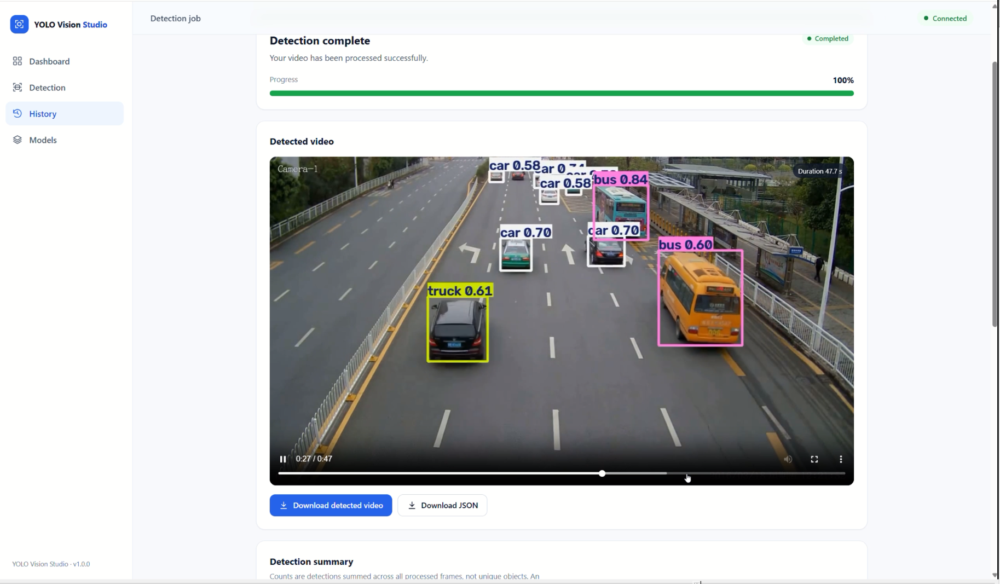
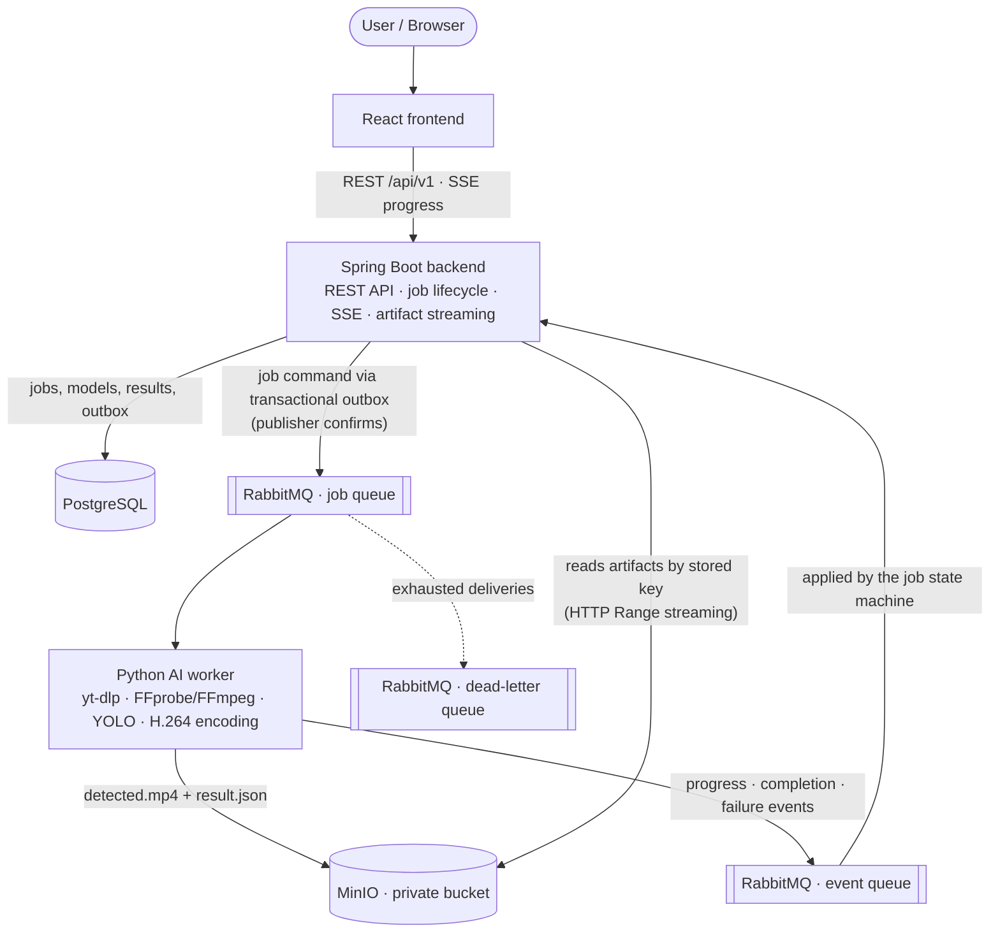

# YOLO Vision Studio

**AI-Powered Video Object Detection Platform**

YOLO Vision Studio is a full-stack platform for running pretrained YOLO object detection models on videos. You paste a YouTube link, pick a YOLO model and detection settings, and the platform processes the video in the background. You can follow progress live, then watch the annotated video, review detection statistics, and download the processed MP4 and its JSON results.

The system is split into independent services:
- **React frontend:** the user interface.
- **Spring Boot backend:** APIs, validation, job coordination, and persistence.
- **Python AI worker:** video acquisition, YOLO inference, and encoding.
- **Supporting infrastructure:** RabbitMQ for asynchronous jobs, PostgreSQL for metadata, and MinIO for video and result artifacts.

## Demo

Watch YOLO Vision Studio in action — from configuring a YOLO model and submitting a video detection job to monitoring progress, viewing detection results, and downloading the processed video.

[](https://youtu.be/3vpkPtPq8nk)

**▶ [Watch the Full Demo on YouTube](https://youtu.be/3vpkPtPq8nk)**

## Key Features

| Area | What it provides |
| --- | --- |
| **Multi-version YOLO** | A catalog of 20 pretrained detection configurations: YOLOv8, YOLO11, YOLO12, and YOLO26, each in Nano, Small, Medium, Large, and Extra Large. Registration does not mean a checkpoint is downloaded or runtime-tested; each model is prepared and enabled explicitly. |
| **Configurable detection** | Model version and size, COCO classes (a *Vehicles* preset, *All objects*, or a searchable custom selection), confidence threshold, and inference image size. |
| **Asynchronous processing** | Jobs are queued through RabbitMQ and processed by a background worker, with tracked status, bounded retries, a dead-letter queue, and recovery of stalled jobs. |
| **Real-time progress** | Live status and progress over Server-Sent Events, with an automatic polling fallback. |
| **Video results** | Annotated H.264 MP4 with bounding boxes and confidence labels, per-class detection statistics, an HTML5 player with seeking, and MP4 and JSON downloads. |
| **Dashboard and history** | Job statistics, recent activity, paginated and filterable job history, and a model catalog with filters. |

## System Architecture



How responsibilities are divided:
- **The React frontend communicates only with Spring Boot.** It never calls the Python worker, RabbitMQ, or MinIO directly.
- **Spring Boot** validates requests, stores job state and model metadata in PostgreSQL, publishes job commands, applies the worker's events, pushes progress to browsers over SSE, and streams artifacts from MinIO.
- **RabbitMQ** decouples the API from long-running inference. It carries job commands to the worker and progress and result events back.
- **The Python AI worker** downloads the video, runs YOLO inference frame by frame, encodes the annotated video, and stores the MP4 and JSON in MinIO.
- **PostgreSQL** holds metadata and job state. **MinIO** holds the large binary artifacts in a private bucket.

## Technology Stack

| Layer | Technologies | Purpose |
| --- | --- | --- |
| Frontend | React 19, TypeScript (strict), Vite, Tailwind CSS 4, React Router, Axios | Single-page user interface |
| Backend | Java 21, Spring Boot 3.5 (Web MVC, Data JPA, Validation, AMQP, Actuator), springdoc-openapi | REST APIs, SSE, job coordination, artifact streaming |
| AI engine | Python 3.11, Ultralytics YOLO, PyTorch (CPU build by default), Pydantic, FastAPI | Object detection, worker health endpoint |
| Video processing | OpenCV, FFmpeg/FFprobe, yt-dlp | Video download, decoding, annotation, H.264 encoding |
| Database | PostgreSQL 17, Flyway | Metadata, job state, versioned schema migrations |
| Messaging | RabbitMQ 4.2 (quorum queues, publisher confirms) | Asynchronous job commands and worker events |
| Object storage | MinIO (S3-compatible) | Annotated videos and result JSON |
| Infrastructure | Docker, Docker Compose, nginx (self-hosted layout) | Containerized deployment |
| Testing | JUnit 5, Spring Boot Test, Testcontainers, Pytest, Vitest, Testing Library | Unit and integration tests |
| CI | GitHub Actions | Automated validation on push and pull request |

Exact dependency versions are pinned in `backend/pom.xml`, `frontend/package-lock.json`, and the `ai-worker/requirements*.txt` files.

## Project Structure

```text
YOLO-Vision-Studio/
├── frontend/                   React + TypeScript single-page application
│   └── src/
│       ├── api/                HTTP client and typed API functions
│       ├── components/         Shared UI, workspace form controls, result views
│       ├── hooks/              Data loading, backend status, SSE progress
│       ├── lib/                Validation, model selection, COCO classes, formatting
│       ├── pages/              Dashboard, Detection, History, Models, Job details
│       └── types/              API data types
├── backend/                    Spring Boot service (package com.yolovision)
│   └── src/
│       ├── main/java/com/yolovision/
│       │   ├── controller/     REST controllers
│       │   ├── service/        Business logic, job lifecycle, SSE progress
│       │   ├── messaging/      RabbitMQ topology, outbox relay, event consumer
│       │   ├── storage/        MinIO artifact access
│       │   ├── entity/ repository/ dto/ config/ exception/
│       ├── main/resources/db/migration/   Flyway migrations (V1–V7)
│       └── test/               Unit, H2, and Testcontainers integration tests
├── ai-worker/                  Python AI worker
│   ├── app/
│   │   ├── services/           YouTube download, video input, YOLO inference,
│   │   │                       encoding, model registry/loader, MinIO storage
│   │   ├── workers/            Detection pipeline, job processor, RabbitMQ consumer
│   │   ├── schemas/            Pydantic message and result schemas
│   │   ├── api/ config/ core/  Health endpoint, settings, errors
│   │   └── cli.py              Model management and local detection CLI
│   └── tests/
├── infrastructure/             MinIO image build and infrastructure notes
├── docs/                       Technical documentation
├── .github/workflows/ci.yml    GitHub Actions pipeline
├── compose.yaml                Local stack (7 services)
├── compose.production.yaml     Hardened self-hosted override
├── .env.example                Configuration template (no credentials)
└── AGENTS.md                   Architecture and contribution rules
```

## How It Works

1. **Submit.** The user submits a YouTube URL, model key, classes, confidence, and image size from the Detection page (`POST /api/v1/detections`).
2. **Validate.** Spring Boot validates the request: a single-video URL, a registered, enabled detection model, and valid parameters.
3. **Persist and enqueue.** In one database transaction, the job is stored as `PENDING` together with an outbox record. The API responds `202 Accepted` with the job ID.
4. **Publish.** The outbox relay publishes the job command to RabbitMQ, waits for publisher confirmation, and moves the job to `QUEUED`.
5. **Consume.** The Python consumer receives the command and loads the requested YOLO model from the prepared cache. Inference runs on CPU by default.
6. **Acquire (`DOWNLOADING`).** yt-dlp downloads the video. H.264 is preferred at the allowed resolution, within duration and size limits.
7. **Prepare the input.** FFprobe validates the video stream. If OpenCV cannot decode the codec, for example AV1 on CPU, FFmpeg converts the input to H.264 first.
8. **Detect (`DETECTING`).** Frames stream through YOLO one at a time. Detections are filtered by confidence and the selected classes, drawn as bounding boxes, and counted per class.
9. **Encode (`ENCODING`).** FFmpeg encodes the annotated frames into a verified H.264/yuv420p MP4.
10. **Store (`UPLOADING`).** `detected.mp4` and `result.json` are uploaded to the private MinIO bucket, and each upload is verified by its stored object size.
11. **Report.** Throughout, the worker publishes progress, heartbeat, completion, or failure events, and Spring Boot applies them to the job in PostgreSQL.
12. **Follow.** The browser receives status and progress through SSE at `/api/v1/detections/{jobId}/events`.
13. **Review (`COMPLETED`).** The user plays the annotated video, reviews the statistics, and downloads the MP4 or JSON, all streamed through Spring Boot.

A job ends as `COMPLETED` or `FAILED`; failures carry a stable error code and a sanitized message.

## Core Methods & Techniques

### YOLO object detection
- **Models.** Pretrained Ultralytics YOLO detection checkpoints, trained on the 80 COCO classes, selected from an approved registry. Model weights are never downloaded at service startup; models load lazily and are cached per process.
- **Detection.** Each video frame is processed independently. Boxes below the confidence threshold or outside the selected COCO class IDs are discarded, and the remaining boxes are drawn with labels and confidence scores.
- **Statistics.** Results report frames processed, total detections, per-class counts, and processing time. These are **detection events summed across frames, not unique objects**; no object tracking is performed, so a car visible in 100 frames counts 100 times.
- **Accuracy.** The project publishes no accuracy, mAP, or FPS benchmarks.

### Asynchronous job processing
Inference on a video takes minutes, so it never runs inside an HTTP request. Spring Boot is the producer, the Python worker is the consumer, and RabbitMQ sits between them.
- **Request path.** The API returns `202 Accepted` immediately.
- **Lifecycle.** The job advances through `PENDING → QUEUED → DOWNLOADING → DETECTING → ENCODING → UPLOADING → COMPLETED` (or `FAILED`).
- **Concurrency.** The worker processes one job at a time by default and keeps its AMQP heartbeats alive during long inference.

### Transactional outbox
A job row and its outbox record are written in the **same PostgreSQL transaction**, so a job can never exist without a pending message, or a message without its job.
- A background relay publishes unsent outbox records to RabbitMQ.
- A record is marked sent only after a **publisher confirm** from the broker.
- If the broker is unavailable, records stay pending and are retried.

### Reliability and idempotency
- **At-least-once delivery.** Messages are acknowledged only after processing and use durable quorum queues, so a crashed worker's job is redelivered.
- **Idempotent state machine.** Status transitions are forward-only. Duplicate or out-of-order events cannot move a job backwards or overwrite a terminal state.
- **Bounded retries.** Failures are classified as permanent (for example an invalid or unreadable video) or transient (for example a download or storage outage). Transient failures are retried a limited number of times with exponential backoff; messages that exhaust their delivery limit go to a dead-letter queue.
- **Lease monitor.** A backend monitor fails jobs that no worker picks up within the queue timeout, and active jobs that send no event within the processing timeout, so nothing hangs forever.
- **Limit.** Delivery is at least once, not exactly once: after a crash a job may be processed again, and the state machine ignores duplicate or stale events.

### Server-Sent Events
The job page opens an `EventSource` to `/api/v1/detections/{jobId}/events`.
- **Snapshots.** One shared backend poller pushes the job's **current state** (status, progress, error) whenever it changes.
- **Heartbeats.** Heartbeats keep idle connections open.
- **Termination.** The stream closes once the job reaches a terminal state.
- **Limits.** Events are snapshots, not a replayed history. If the stream fails, the frontend falls back to periodic polling. A connection cap protects the server.

### Object storage and media streaming
- **Storage.** Artifacts live in a **private** MinIO bucket that the browser never accesses directly.
- **Access checks.** Spring Boot looks up object keys from the database only after checking job status and key ownership, then streams the file.
- **Streaming.** The video endpoint supports HTTP `Range` requests (`206 Partial Content`), so the native player can seek without downloading the whole file.
- **Downloads.** Download endpoints serve the MP4 and `result.json` as attachments.

### Containerization and CI
- **Containers.** Every service runs in a container defined in `compose.yaml`, with health checks, named volumes for data and the model cache, and ports bound to `127.0.0.1`.
- **Self-hosted layout.** `compose.production.yaml` serves the built frontend through unprivileged nginx with security headers and unbuffered SSE and Range proxying. It publishes only the UI port and disables Swagger.
- **CI.** A GitHub Actions workflow runs every test suite on each push and pull request.

## REST API

All endpoints are under `/api/v1`. Errors use RFC 9457 problem details with stable error codes.

| Method | Endpoint | Description |
| --- | --- | --- |
| GET | `/api/v1/system/info` | Application name, version, and status |
| GET | `/api/v1/models` | Model catalog (filters: `version`, `size`, `enabled`) |
| GET | `/api/v1/models/versions` | Registered YOLO versions in release order |
| GET | `/api/v1/models/{modelKey}` | One model configuration |
| POST | `/api/v1/detections` | Create a detection job (`202 Accepted` + `Location`) |
| GET | `/api/v1/detections` | Paged job history (filters: `status`, `modelKey`) |
| GET | `/api/v1/detections/{jobId}` | Job details and current status |
| GET | `/api/v1/detections/{jobId}/result` | Result metadata and detection statistics |
| GET | `/api/v1/detections/{jobId}/events` | Live progress (Server-Sent Events) |
| GET | `/api/v1/detections/{jobId}/video` | Stream the annotated MP4 (HTTP Range) |
| GET | `/api/v1/detections/{jobId}/video/download` | Download the annotated MP4 |
| GET | `/api/v1/detections/{jobId}/result.json` | Original worker result JSON |
| GET | `/api/v1/detections/{jobId}/result.json/download` | Download the result JSON |

Interactive documentation is served by Swagger UI at `/api/v1/docs`, and the OpenAPI document at `/api/v1/openapi`, in the development layout. See the [detection REST API guide](docs/detection-rest-api.md) for request and response schemas and error codes.

## Getting Started

### Prerequisites
Docker Desktop or Docker Engine with the Compose v2 plugin. No GPU is required; inference runs on CPU by default.

### 1. Configure the environment
From the repository root (PowerShell):

```powershell
# Create .env only if it does not exist yet; never overwrite an existing one.
if (-not (Test-Path .env)) { Copy-Item .env.example .env }
```

Set `DB_PASSWORD`, `RABBITMQ_PASSWORD`, and `MINIO_ROOT_PASSWORD` in `.env` to independently generated values. MinIO needs at least 8 characters. Compose refuses to start without them, and `.env` is ignored by Git.

### 2. Start the stack

```powershell
docker compose config --quiet   # validate configuration
docker compose up -d --build    # first build installs CPU inference packages; it takes a while
docker compose ps               # all services should become healthy
```

| Service | Default local address |
| --- | --- |
| Frontend | http://localhost:5173 |
| Backend API / Swagger UI | http://localhost:8080/api/v1/system/info · http://localhost:8080/api/v1/docs |
| RabbitMQ management | http://localhost:15672 |
| MinIO console | http://localhost:9001 |

All ports bind to `127.0.0.1`. If a port is taken, override it in `.env` (for example `BACKEND_PORT=18080`, `POSTGRES_PORT=15432`). `docker compose down` keeps data volumes; **`docker compose down -v` deletes all jobs, videos, and prepared models.**

### 3. Prepare and enable a model
Images ship **without** YOLO weights, and all 20 catalog entries start disabled. Prepare a model in the worker's persistent cache, which downloads the official checkpoint, loads it, and verifies it:

```powershell
docker compose exec ai-detection-consumer python -m app.cli models prepare --model yolo11n --device cpu
docker compose exec ai-detection-consumer python -m app.cli models status --model yolo11n
```

Then enable that model in PostgreSQL as an administrator, one model at a time, as described in the [model management guide](docs/yolo-model-management.md). Enabled models become selectable on the Detection page.

### Self-hosted layout

```powershell
docker compose -f compose.yaml -f compose.production.yaml up -d --build
```

This serves the static frontend through nginx on a single localhost port and disables Swagger. See the [deployment guide](docs/deployment-guide.md) for the full setup, backups, and upgrades, and the [operations runbook](docs/operations-runbook.md) for troubleshooting.

## Testing & CI/CD

| Suite | Command | Notes |
| --- | --- | --- |
| Frontend | `cd frontend; npm ci; npm test; npm run build` | Vitest + Testing Library; `build` runs strict TypeScript |
| Backend | `cd backend; .\mvnw.cmd test` | Unit and H2-backed tests |
| Backend integration | `cd backend; .\mvnw.cmd -Ppostgres-it verify` | PostgreSQL 17, RabbitMQ, and MinIO via Testcontainers. Requires Docker; run `docker compose build minio` once first |
| AI worker | `cd ai-worker; .\.venv\Scripts\python.exe -m pytest` | Install `requirements-ai-cpu.txt`, then `requirements-ai.txt` and `requirements-dev.txt`. Real-media tests need FFmpeg |

On macOS or Linux, use `./mvnw` and `.venv/bin/python`. Source development requires Java 21, Node.js `^22.22.2 || ^24.15.0 || >=26`, Python 3.11, and FFmpeg.

[GitHub Actions](.github/workflows/ci.yml) runs four jobs on every push to `main` and on pull requests:
- frontend tests and build
- backend tests and packaging
- the AI worker test suite
- backend integration tests with Testcontainers

CI needs no secrets, and it does not download videos or YOLO weights. Live YouTube downloads and browser end-to-end checks are not part of CI.

## Documentation

| Topic | Guide |
| --- | --- |
| Architecture and API contracts | [docs/architecture.md](docs/architecture.md) |
| REST API and SSE | [docs/detection-rest-api.md](docs/detection-rest-api.md) |
| Database design and persistence tests | [docs/database-design.md](docs/database-design.md) |
| AI detection engine and CLI | [docs/ai-detection-engine.md](docs/ai-detection-engine.md) |
| YOLO model management | [docs/yolo-model-management.md](docs/yolo-model-management.md) |
| Asynchronous job processing | [docs/asynchronous-job-processing.md](docs/asynchronous-job-processing.md) |
| Video streaming and downloads | [docs/video-preview-download.md](docs/video-preview-download.md) |
| Frontend, Detection workspace, UI design | [docs/frontend-dashboard.md](docs/frontend-dashboard.md) · [docs/video-detection-workspace.md](docs/video-detection-workspace.md) · [docs/ui-ux-redesign.md](docs/ui-ux-redesign.md) |
| Deployment and operations | [docs/deployment-guide.md](docs/deployment-guide.md) · [docs/operations-runbook.md](docs/operations-runbook.md) |
| Development environment | [docs/development.md](docs/development.md) |

Validation reports and the project roadmap are kept in [`docs/`](docs/) for reference.

## Limitations

- **No authentication or per-user authorization.** Run it on localhost or a trusted private network. Public or multi-user deployment needs authentication, job ownership, rate limiting, and TLS.
- **YouTube availability varies.** Downloads depend on each video's availability and access restrictions; private, age- or region-restricted, and live videos fail.
- **Models need preparation.** A catalog entry is usable only after its checkpoint has been prepared in the worker cache and the model has been enabled.
- **Counts are detection events, not unique objects.** There is no object tracking, so counts are summed across frames.
- **CPU by default.** The default worker image uses CPU inference, so processing long or high-resolution videos takes time.
