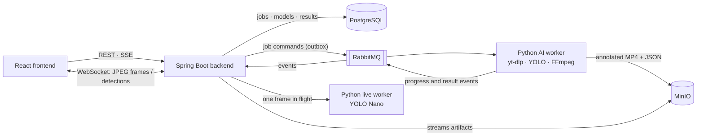
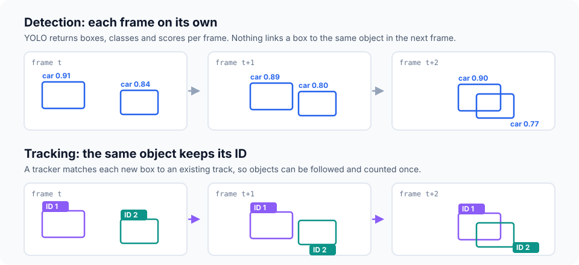
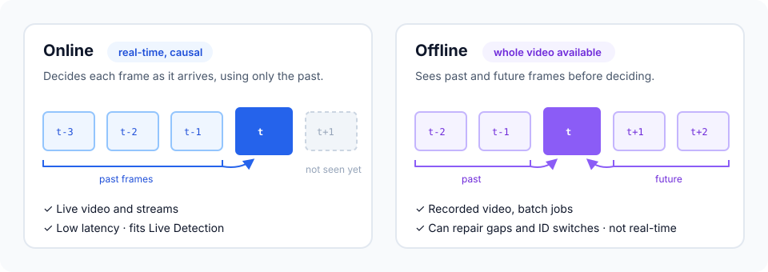
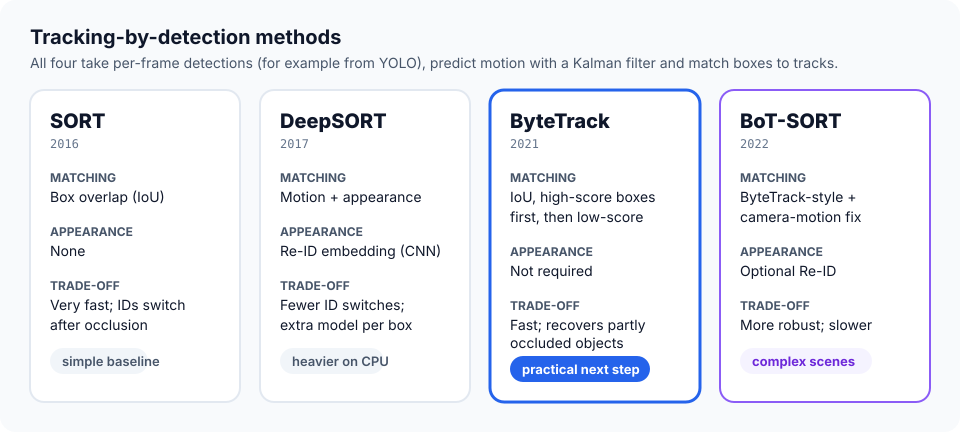

# YOLO Vision Studio

**AI-Powered Video Object Detection Platform**

YOLO Vision Studio runs pretrained YOLO models on videos. Paste a YouTube link, choose a model and detection settings, and the video is processed in the background. You follow progress live, then play the annotated video, review per-class statistics, and download the MP4 and JSON results. A Live Detection page also runs a YOLO Nano model on your webcam in real time.

## Product Showcase

A 55-second silent overview: the dashboard, configuring a detection job, the service architecture, real annotated results from a completed job, and Live Detection. All product screens are real captures of the running app. In the Live Detection clip, a sample street video is used as the camera input.

https://github.com/user-attachments/assets/ff193771-b136-4402-aa20-85f424f79d38

A longer walkthrough is on YouTube: [watch the full demo](https://youtu.be/3vpkPtPq8nk).

## Key Features

- **Video detection from a YouTube URL**: single public videos are downloaded, validated, and processed as background jobs.
- **Model selection**: a catalog of 20 detection configurations (YOLOv8, YOLO11, YOLO12, YOLO26 × Nano to Extra Large). Each model is prepared and enabled explicitly.
- **Detection settings**: COCO classes (*Vehicles* preset, *All objects*, or a custom selection), confidence threshold, and image size.
- **Live job progress**: status and progress over Server-Sent Events, with a polling fallback.
- **Dashboard and history**: job statistics, recent activity, and a filterable, paginated job history.
- **Downloadable results**: annotated H.264 MP4 with boxes and labels, per-class counts, an in-app player with seeking, and MP4 and JSON downloads.
- **Live Detection**: browser webcam frames analysed by a Nano model at up to 5 FPS, with boxes drawn over the preview and measured FPS and latency. Frames are never stored.
- **Reliable processing**: transactional outbox, at-least-once delivery, bounded retries, a dead-letter queue, and recovery of stalled jobs.

## System Architecture



- **React** talks only to Spring Boot; it never calls the workers, RabbitMQ, or MinIO directly.
- **Spring Boot** owns the APIs, validation, the job state machine, SSE progress, artifact streaming, and the live WebSocket gateway.
- **RabbitMQ** decouples the API from long-running inference: job commands go out, progress and result events come back.
- **Python AI worker** downloads the video, runs YOLO frame by frame, encodes the annotated MP4, and stores results in MinIO.
- **Python live worker** answers single-frame requests from Spring Boot on the internal network only.
- **PostgreSQL** stores jobs and metadata (Flyway migrations); **MinIO** stores the large artifacts in a private bucket.

Job lifecycle: `PENDING → QUEUED → DOWNLOADING → DETECTING → ENCODING → UPLOADING → COMPLETED` (or `FAILED` with a stable error code).

## Tech Stack

| Layer | Technologies |
| --- | --- |
| Frontend | React 19, TypeScript (strict), Vite, Tailwind CSS 4, React Router |
| Backend | Java 21, Spring Boot 3.5 (Web MVC, Data JPA, AMQP, WebSocket), springdoc-openapi |
| AI and video | Python 3.11, Ultralytics YOLO, PyTorch (CPU by default), FastAPI, OpenCV, FFmpeg, yt-dlp |
| Data and messaging | PostgreSQL 17 + Flyway, RabbitMQ 4.2 (quorum queues, publisher confirms), MinIO |
| Infrastructure | Docker Compose, nginx (self-hosted layout), GitHub Actions |
| Testing | JUnit 5, Testcontainers, Pytest, Vitest, Testing Library |

## Object Tracking Methods

YOLO Vision Studio currently performs **detection only**: every frame is analysed independently, so its statistics are detection events summed across frames, not unique objects. **Tracking** is the natural next step. It links detections across frames so each object keeps a persistent ID, which enables trajectories and unique counts. Tracking is not implemented yet; this section describes the design options.



- **Online tracking** decides frame by frame using only past frames. It works for live streams and suits both Live Detection and the background worker.
- **Offline tracking** sees the whole video before deciding. It can repair gaps and ID switches, but it is not real-time.



Common tracking-by-detection methods take YOLO boxes as input:

- **SORT**: Kalman-filter motion and IoU matching. Very fast, but IDs switch after occlusions.
- **DeepSORT**: adds an appearance (Re-ID) embedding per box. Fewer ID switches, at the cost of an extra model.
- **ByteTrack**: matches high-confidence boxes first, then low-confidence ones, to recover partly occluded objects without an appearance model.
- **BoT-SORT**: builds on ByteTrack with camera-motion compensation and optional Re-ID. More robust, but slower.



**Recommendation for this project:** start with **ByteTrack**. It is online, needs no extra model (important on CPU), and Ultralytics ships it (`bytetrack.yaml`), so it can be added in the worker's inference loop. **BoT-SORT** (`botsort.yaml`) is the option for moving cameras or crowded scenes.

## Quick Start

**Prerequisites:** Docker with the Compose v2 plugin. No GPU is needed; inference runs on CPU by default.

```powershell
# 1. Configure: create .env once, then set DB_PASSWORD, RABBITMQ_PASSWORD and MINIO_ROOT_PASSWORD (8+ characters).
if (-not (Test-Path .env)) { Copy-Item .env.example .env }

# 2. Start the stack (the first build takes a while).
docker compose up -d --build
docker compose ps

# 3. Prepare a model in the worker's cache (images ship without weights).
docker compose exec ai-detection-consumer python -m app.cli models prepare --model yolo11n --device cpu
```

Then enable the model in PostgreSQL, as described in the [model management guide](docs/yolo-model-management.md), and open **http://localhost:5173**. Enabled Nano models also appear on the Live Detection page (`/live`); the camera needs `localhost` or HTTPS.

| Service | Address |
| --- | --- |
| Web app | http://localhost:5173 |
| API · Swagger UI | http://localhost:8080/api/v1/system/info · http://localhost:8080/api/v1/docs |
| RabbitMQ · MinIO consoles | http://localhost:15672 · http://localhost:9001 |

All ports bind to `127.0.0.1`. `docker compose down` keeps data; `docker compose down -v` deletes all jobs, videos, and prepared models. For the nginx-based self-hosted layout, see the [deployment guide](docs/deployment-guide.md).

**Tests:** `cd frontend; npm test` · `cd backend; .\mvnw.cmd test` (add `-Ppostgres-it verify` for Testcontainers integration tests) · `cd ai-worker; python -m pytest`. GitHub Actions runs all suites on every push and pull request.

## Repository Structure

```text
frontend/         React + TypeScript app (pages, components, hooks, API clients)
backend/          Spring Boot service (com.yolovision): controllers, services, messaging, storage, Flyway migrations
ai-worker/        Python worker: download, YOLO inference, encoding, RabbitMQ consumer, live inference service
infrastructure/   MinIO image build and infrastructure notes
docs/             Technical guides and diagrams
compose.yaml      Local stack (8 services); compose.production.yaml adds the hardened self-hosted layout
```

Further reading: [architecture](docs/architecture.md) · [REST API](docs/detection-rest-api.md) · [asynchronous jobs](docs/asynchronous-job-processing.md) · [AI engine](docs/ai-detection-engine.md) · [Live Detection](docs/live-detection-architecture.md) · [operations runbook](docs/operations-runbook.md).

## Notes and Limitations

- **No authentication.** Run it on localhost or a trusted network; public deployment needs authentication, rate limiting, and TLS.
- **Detection events, not unique objects.** Without tracking, an object visible in many frames is counted in each frame.
- **Models need preparation.** A catalog model is usable only after its weights are prepared and it is enabled.
- **YouTube availability varies.** Private, restricted, and live videos fail.
- **CPU by default.** Long or high-resolution videos take time; Live Detection allows one session at up to 5 FPS.
- **No published benchmarks.** The project reports no accuracy, mAP, or FPS benchmarks.

## License

No license file has been added yet, so the code is not licensed for reuse or redistribution. Add a `LICENSE` file to choose one.
