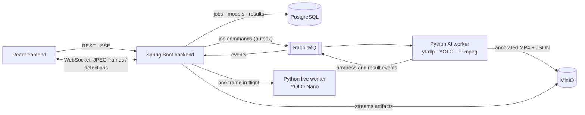
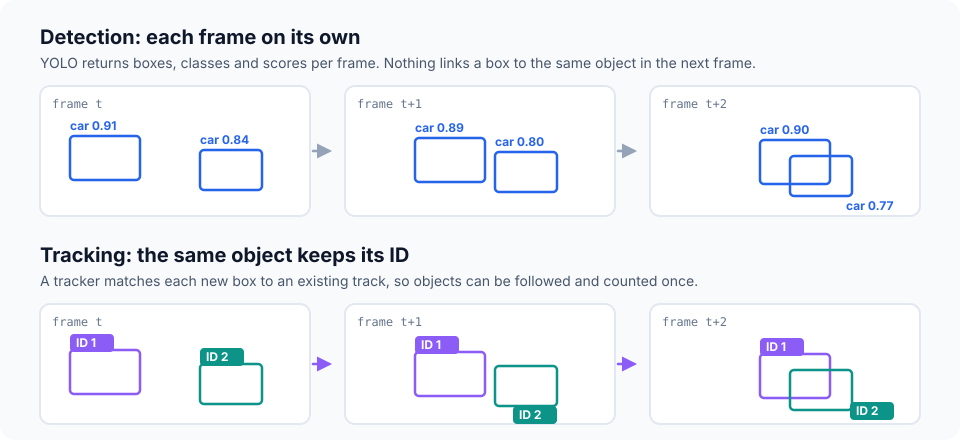
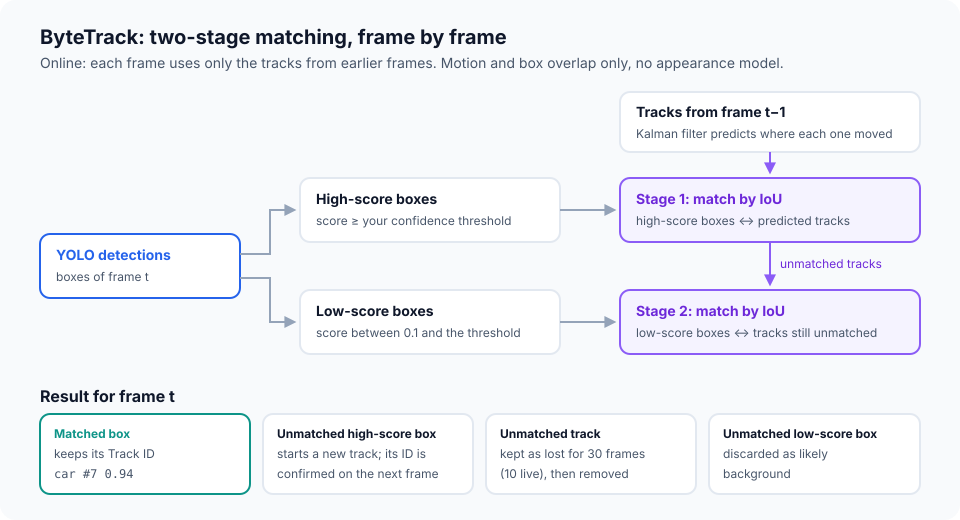

# YOLO Vision Studio

**AI-Powered Video Object Detection Platform**

YOLO Vision Studio runs pretrained YOLO models on videos. Paste a YouTube link, choose a model and detection settings, and the video is processed in the background. You follow progress live, then play the annotated video, review per-class statistics, and download the MP4 and JSON results. Optional ByteTrack tracking gives each object a persistent Track ID across frames. A Live Detection page also runs a YOLO Nano model on your webcam in real time, with or without tracking.

## Product Showcase

A 55-second silent overview: the dashboard, configuring a detection job with object tracking, the service architecture, a completed tracking job (Track ID labels, trails, and ByteTrack statistics), and Live Detection with live Track IDs. All product screens are real captures of the running app. In the Live Detection clip, a sample street video is used as the camera input.

https://github.com/user-attachments/assets/1db135f4-5bd6-42dd-8dfc-08f206d9dec9

A longer walkthrough is on YouTube: [watch the full demo](https://youtu.be/3vpkPtPq8nk).

## Key Features

- **Video detection from a YouTube URL**: single public videos are downloaded, validated, and processed as background jobs.
- **Model selection**: a catalog of 20 detection configurations (YOLOv8, YOLO11, YOLO12, YOLO26 × Nano to Extra Large). Each model is prepared and enabled explicitly.
- **Detection settings**: COCO classes (*Vehicles* preset, *All objects*, or a custom selection), confidence threshold, and image size.
- **Live job progress**: status and progress over Server-Sent Events, with a polling fallback.
- **Dashboard and history**: job statistics, recent activity, and a filterable, paginated job history.
- **Downloadable results**: annotated H.264 MP4 with boxes and labels, per-class counts, an in-app player with seeking, and MP4 and JSON downloads.
- **Live Detection**: browser webcam frames analysed by a Nano model at up to 5 FPS, with boxes drawn over the preview and measured FPS and latency. Frames are never stored.
- **Object tracking (ByteTrack)**: an opt-in mode for video jobs and Live Detection. Detections keep a persistent Track ID (`car #7 0.94`) with short trails, and results report unique track IDs next to detection counts.
- **Reliable processing**: transactional outbox, at-least-once delivery, bounded retries, a dead-letter queue, and recovery of stalled jobs.

## System Architecture



- **React** talks only to Spring Boot; it never calls the workers, RabbitMQ, or MinIO directly.
- **Spring Boot** owns the APIs, validation, the job state machine, SSE progress, artifact streaming, and the live WebSocket gateway.
- **RabbitMQ** decouples the API from long-running inference: job commands go out, progress and result events come back.
- **Python AI worker** downloads the video, runs YOLO frame by frame, encodes the annotated MP4, and stores results in MinIO.
- **Python live worker** answers single-frame requests from Spring Boot on the internal network only.
- **PostgreSQL** stores jobs and metadata (Flyway migrations); **MinIO** stores the large artifacts in a private bucket.

Job lifecycle: `PENDING → QUEUED → DOWNLOADING → DETECTING → ENCODING → UPLOADING → COMPLETED` (or `FAILED` with a stable error code).

## Tech Stack

| Layer | Technologies |
| --- | --- |
| Frontend | React 19, TypeScript (strict), Vite, Tailwind CSS 4, React Router |
| Backend | Java 21, Spring Boot 3.5 (Web MVC, Data JPA, AMQP, WebSocket), springdoc-openapi |
| AI and video | Python 3.11, Ultralytics YOLO, PyTorch (CPU by default), FastAPI, OpenCV, FFmpeg, yt-dlp |
| Data and messaging | PostgreSQL 17 + Flyway, RabbitMQ 4.2 (quorum queues, publisher confirms), MinIO |
| Infrastructure | Docker Compose, nginx (self-hosted layout), GitHub Actions |
| Testing | JUnit 5, Testcontainers, Pytest, Vitest, Testing Library |

## Object Tracking with ByteTrack

Detection analyses every frame independently, so its statistics are detection events summed across frames, not unique objects. **Tracking** links detections across frames so each object keeps a persistent ID. YOLO Vision Studio offers both: **Detection only** (the default) and **Detection + Tracking** with ByteTrack, switched on per video job or per Live Detection session.



ByteTrack takes the YOLO boxes of each frame and matches them to the tracks of earlier frames in two stages. High-score boxes are matched first; low-score boxes then get a second chance against the tracks still unmatched, which keeps IDs through partial occlusion.



- **Online and lightweight:** each frame uses only earlier frames, with a Kalman filter for motion and box overlap (IoU) for matching. There is no appearance model, so it runs on CPU, adds no model download, and ships with Ultralytics.
- **One forward pass for videos:** recorded YouTube videos are tracked in the same single pass as detection, exactly like a live stream.
- **Per job and per session:** each video job and each live session gets its own tracker, with IDs starting at 1. The model weights stay shared, and track state is released when the job ends or the session stops.
- **Detection counts are unchanged:** they mean the same as in Detection only. Unique track IDs are reported separately and approximate, but do not guarantee, the number of distinct objects, because occlusion can split or swap IDs.

Details, contracts, and limitations are in the [object tracking guide](docs/object-tracking.md).

## Quick Start

**Prerequisites:** Docker with the Compose v2 plugin. No GPU is needed; inference runs on CPU by default.

```powershell
# 1. Configure: create .env once, then set DB_PASSWORD, RABBITMQ_PASSWORD and MINIO_ROOT_PASSWORD (8+ characters).
if (-not (Test-Path .env)) { Copy-Item .env.example .env }

# 2. Start the stack (the first build takes a while).
docker compose up -d --build
docker compose ps

# 3. Prepare a model in the worker's cache (images ship without weights).
docker compose exec ai-detection-consumer python -m app.cli models prepare --model yolo11n --device cpu
```

Then enable the model in PostgreSQL, as described in the [model management guide](docs/yolo-model-management.md), and open **http://localhost:5173**. Enabled Nano models also appear on the Live Detection page (`/live`); the camera needs `localhost` or HTTPS.

| Service | Address |
| --- | --- |
| Web app | http://localhost:5173 |
| API · Swagger UI | http://localhost:8080/api/v1/system/info · http://localhost:8080/api/v1/docs |
| RabbitMQ · MinIO consoles | http://localhost:15672 · http://localhost:9001 |

All ports bind to `127.0.0.1`. `docker compose down` keeps data; `docker compose down -v` deletes all jobs, videos, and prepared models. For the nginx-based self-hosted layout, see the [deployment guide](docs/deployment-guide.md).

**Tests:** `cd frontend; npm test` · `cd backend; .\mvnw.cmd test` (add `-Ppostgres-it verify` for Testcontainers integration tests) · `cd ai-worker; python -m pytest`. GitHub Actions runs all suites on every push and pull request.

## Repository Structure

```text
frontend/         React + TypeScript app (pages, components, hooks, API clients)
backend/          Spring Boot service (com.yolovision): controllers, services, messaging, storage, Flyway migrations
ai-worker/        Python worker: download, YOLO inference, encoding, RabbitMQ consumer, live inference service
infrastructure/   MinIO image build and infrastructure notes
docs/             Technical guides and diagrams
compose.yaml      Local stack (8 services); compose.production.yaml adds the hardened self-hosted layout
```

Further reading: [architecture](docs/architecture.md) · [REST API](docs/detection-rest-api.md) · [asynchronous jobs](docs/asynchronous-job-processing.md) · [AI engine](docs/ai-detection-engine.md) · [Live Detection](docs/live-detection-architecture.md) · [object tracking](docs/object-tracking.md) · [operations runbook](docs/operations-runbook.md).

## Notes and Limitations

- **No authentication.** Run it on localhost or a trusted network; public deployment needs authentication, rate limiting, and TLS.
- **Detection events, not unique objects.** An object visible in many frames is counted in each frame. With tracking, unique track IDs are an approximation: long occlusions and crowded scenes can split or swap IDs.
- **Models need preparation.** A catalog model is usable only after its weights are prepared and it is enabled.
- **YouTube availability varies.** Private, restricted, and live videos fail.
- **CPU by default.** Long or high-resolution videos take time; Live Detection allows one session at up to 5 FPS.
- **No published benchmarks.** The project reports no accuracy, mAP, or FPS benchmarks.

## License

No license file has been added yet, so the code is not licensed for reuse or redistribution. Add a `LICENSE` file to choose one.
