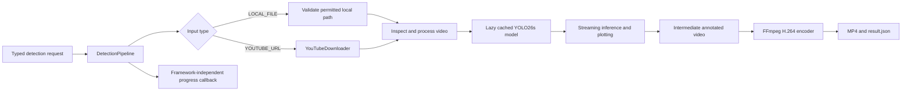

# AI video detection engine

## Architecture and scope

Phase 03 adds an independently executable Python video engine. It accepts a permitted local file or an authorized single YouTube video, applies YOLO26s, and produces annotated H.264 MP4 plus measured JSON metadata. It does not update PostgreSQL, enable registered models, publish or consume RabbitMQ messages, transfer MinIO objects, or add public inference endpoints.

The existing Kaggle notebook is not present in the repository. This implementation follows the supplied notebook behavior: preferred download height of 720p, streaming prediction, configurable classes/confidence/image size, and H.264 export with audio removed. It has no Kaggle paths, notebook installation cells, or IPython display code.



## Modules and processing flow

| Module | Responsibility |
| --- | --- |
| `app/config/settings.py` | Validated HTTP and engine environment settings |
| `app/core/exceptions.py` | Meaningful source/download/model/inference/processing/encoding errors |
| `app/schemas/` | Typed requests, video metadata, boxes, statistics, results, and progress events |
| `app/services/model_loader.py` | Model identifier validation, device selection, lazy loading, process-local cache |
| `app/services/youtube_downloader.py` | Restricted YouTube URL validation, bounded single-video download, actual finalized path |
| `app/services/detection_service.py` | Streaming Ultralytics predictions, annotations, box information, class validation |
| `app/services/video_processor.py` | Input metadata/limits, frame writing, statistics, resource cleanup |
| `app/services/video_encoder.py` | FFmpeg invocation, output validation, temporary conversion cleanup |
| `app/workers/detection_pipeline.py` | Source resolution, unique directories, orchestration, result JSON, completion/failure |
| `app/cli.py` | Independent command-line interface with progress and nonzero failure exit status |
| `app/smoke.py` | Explicit generated-video smoke test with real inference |

The pipeline validates the request and permitted paths, creates a unique workspace, resolves the source, inspects video metadata, loads the model only when needed, processes one frame result at a time, encodes the intermediate video, writes JSON metadata, finalizes successful output, and cleans temporary resources. User-selected output paths are constrained to the configured output root and must not overwrite unrelated files.

## Model loading and devices

Only `yolo26s` / official `yolo26s.pt` detection weights are supported in this phase. Arbitrary user-supplied model files and filesystem paths are rejected. A model cache avoids reloading a previously loaded model for the same cache location and actual device. The inference path serializes access to a shared model as required by Ultralytics' mutable predictor state.

Heavy packages and model objects are not loaded during module import or FastAPI startup. Weights may download only after explicit inference or an explicit model preparation command. Cached weights are reused and never committed.

| Device setting | Behavior |
| --- | --- |
| `auto` | Select CUDA when available, otherwise CPU |
| `cpu` | Run CPU inference |
| `cuda:0` | Require an available CUDA device; fail clearly if unavailable |

The result records the actual device, model key, selected classes, confidence threshold, and image size. CUDA support also requires an appropriate PyTorch build and host drivers. The default container deliberately uses CPU-only PyTorch.

## Inputs, metadata, and limits

Local files must resolve inside `AI_LOCAL_INPUT_DIR`. Traversal and symlinks resolving outside the allowed root are rejected. A remote URL is never inferred to be a local filename or accepted as an arbitrary download source.

Metadata includes width, height, FPS, duration when known, and estimated total frame count. Metadata frame count is distinct from the actual number of frames successfully processed. Missing FPS is handled with the configured fallback and marked as estimated. Unknown frame counts do not cause division by zero or fake 100% progress. Readable frames, valid dimensions, configured duration/size limits, and available writer support are checked before successful completion can be reported.

Video processing remains streaming: it does not load the entire video or retain every result in memory. Per-frame box detections are accumulated into class totals; frames with no detections are still written. Generated output is required to be nonempty and decodable.

## YouTube downloader and JavaScript runtime

The downloader accepts supported single-video YouTube URLs only. It validates the URL scheme and exact supported hosts, rejects playlist/live requests and malformed video identifiers, canonicalizes accepted video references, checks metadata duration and known size, and enforces actual download limits. It uses yt-dlp's Python API with argument data rather than shell commands.

The preferred format is `bv[height<=720]+ba/b[height<=720]`, with the height configurable. Downloads use unique directories and are not assumed to be MP4: MP4, WebM, and MKV finalized files are supported. The returned path is validated from finalized downloader information rather than selecting an arbitrary directory entry. Incomplete downloads are removed on failure.

Current yt-dlp YouTube operations may require a supported JavaScript runtime. Deno is the default configured runtime; install it on `PATH` or set `AI_YOUTUBE_JS_RUNTIME_PATH` to its executable. The AI requirements include yt-dlp's default extras and matching EJS challenge-solver support. No notebook-specific Deno path is used, and no cookie extraction, authentication bypass, DRM bypass, or private-content workflow is implemented. Restricted or unavailable content returns an error. Use only content you are authorized to download and process.

The default worker image includes yt-dlp/EJS but does not bundle Deno. Add a supported Linux runtime to a derived image or mount its executable and configure its path before using YouTube operations that require it. Local-file inference does not need a JavaScript runtime.

Refer to the [official yt-dlp JavaScript-runtime guidance](https://github.com/yt-dlp/yt-dlp/wiki/EJS) when installing or updating the runtime. Live YouTube verification must be reported separately from mocked downloader tests.

## FFmpeg export

FFmpeg and FFprobe must be available on `PATH` or through their settings. The encoder uses subprocess argument lists with no shell expansion, checks process status, captures useful error context, writes to an owned temporary MP4, and validates the resulting media before finalizing it. Existing destination files are not overwritten.

The export uses H.264 (`libx264`), preset `fast`, CRF 23, pixel format `yuv420p`, `+faststart`, and `-an`. Audio is intentionally removed, matching the original notebook. Where necessary, even-dimension padding supports H.264/yuv420p without discarding frame content. FFprobe checks stream properties, and a decode check ensures the file is playable rather than merely present on disk.

## Configuration reference

All engine settings use environment variables. Base HTTP settings `AI_WORKER_HOST`, `AI_WORKER_PORT`, and `LOG_LEVEL` retain their existing behavior. Direct Python processes do not automatically load the root `.env`; export the desired settings before starting them.

| Variable | Default | Purpose |
| --- | --- | --- |
| `AI_DEVICE` | `auto` | Requested inference device |
| `AI_MODEL_CACHE_DIR` | `model-cache` | Official model weights/cache root |
| `AI_TEMP_DIR` | `temp` | Unique execution workspace parent |
| `AI_OUTPUT_DIR` | `outputs` | Permitted final output root |
| `AI_LOCAL_INPUT_DIR` | `.` | Permitted local input root |
| `AI_DEFAULT_CONFIDENCE` | `0.25` | Detection confidence, from 0 through 1 |
| `AI_DEFAULT_IMAGE_SIZE` | `960` | Positive inference image size |
| `AI_MAX_VIDEO_DURATION_SECONDS` | `300` | Maximum source duration |
| `AI_MAX_VIDEO_SIZE_MB` | `200` | Maximum source/download size |
| `AI_MAX_DOWNLOAD_HEIGHT` | `720` | Preferred YouTube resolution ceiling |
| `AI_FFMPEG_PATH` | `ffmpeg` | FFmpeg executable |
| `AI_FFPROBE_PATH` | `ffprobe` | FFprobe executable |
| `AI_YOUTUBE_JS_RUNTIME` | `deno` | yt-dlp JavaScript runtime name |
| `AI_YOUTUBE_JS_RUNTIME_PATH` | unset | Optional configured runtime executable |
| `AI_CPU_THREADS` | `4` | CPU inference/thread budget |
| `AI_MAX_FRAME_PIXELS` | `8294400` | Maximum decoded frame area |
| `AI_FALLBACK_FPS` | `30` | Explicit fallback for unusable source FPS |
| `AI_PROCESSING_TIMEOUT_SECONDS` | `1800` | External processing timeout |

Container defaults use absolute paths under `/data`; Compose provides model cache, temporary storage, and output named volumes. Direct-process defaults resolve relative to the working directory, so run commands from `ai-worker/` unless intentionally configuring different roots.

## Installation and CLI

### Windows PowerShell

Install Python 3.11, FFmpeg/FFprobe, and optionally Deno for YouTube. Use a Python environment rather than the Windows Store alias if that alias is not a real interpreter.

```powershell
Set-Location ai-worker
python -m venv .venv
.\.venv\Scripts\python.exe -m pip install -r requirements-dev.txt
.\.venv\Scripts\python.exe -m pip install -r requirements-ai-cpu.txt
.\.venv\Scripts\python.exe -m pip install -r requirements-ai.txt

$env:AI_LOCAL_INPUT_DIR = (Get-Location).Path
$env:AI_DEVICE = 'cpu'
# Set these only when the executables are not on PATH.
# $env:AI_FFMPEG_PATH = 'C:\Tools\ffmpeg\bin\ffmpeg.exe'
# $env:AI_FFPROBE_PATH = 'C:\Tools\ffmpeg\bin\ffprobe.exe'

.\.venv\Scripts\python.exe -m app.cli detect `
  --source 'sample.mp4' --source-type local `
  --model yolo26s --confidence 0.25 --imgsz 960 `
  --classes 1,2,3,5,7 --device cpu
```

Use `--output 'outputs/result.mp4'` to request an allowed explicit destination, or omit it for an automatically unique directory. Use `python -m app.cli --help` and `python -m app.cli detect --help` for the actual supported arguments. The CLI returns nonzero when source validation, downloading, model loading, inference, or encoding fails.

`python -m app.cli prepare-model --model yolo26s --device cpu` explicitly prepares official weights without processing a video. It may download weights and is never run automatically by health startup or the normal test suite.

For an authorized YouTube source, replace the source options with `--source 'https://www.youtube.com/watch?v=<video-id>' --source-type youtube`. The placeholder must be replaced by an actual authorized video; this documentation does not imply that a live download was tested.

If `uv` is already installed, `uv python install 3.11`, `uv venv --python 3.11 .venv`, and `uv pip install --python .venv/Scripts/python.exe -r <requirements-file>` are alternatives. Install the CPU bootstrap before common AI requirements in the same environment.

### Linux and Docker

Use `python3.11 -m venv .venv` and `.venv/bin/python` on Linux. Install the distribution's FFmpeg package, which should provide both FFmpeg and FFprobe. The pinned CPU bootstrap supports the project's Windows/Linux x86_64 setup; other architectures need an appropriate supported PyTorch installation.

From the monorepo root:

```bash
docker build -t yolo-vision-ai-worker:local ./ai-worker
docker run --rm -p 8000:8000 yolo-vision-ai-worker:local

# Run the standalone CLI with a read-only input directory and persistent outputs.
docker run --rm \
  -v "$PWD/ai-worker/inputs:/data/inputs:ro" \
  -v "$PWD/ai-worker/outputs:/data/outputs" \
  -v yolo-model-cache:/data/models \
  yolo-vision-ai-worker:local \
  python -m app.cli detect --source /data/inputs/sample.mp4 --source-type local --device cpu
```

Create the input/output directories and place a permitted sample file in `ai-worker/inputs/` first. Docker runs the worker as a nonroot user, so bind-mounted directories must allow that user's required access. Do not mount unrelated host directories into the worker.

The default Docker target `cpu` includes CPU PyTorch, headless OpenCV, yt-dlp, FFmpeg, and FFprobe. The optional `base` target keeps the HTTP application and system FFmpeg without installing AI Python packages. Neither target loads a model at startup or includes model weights. To use CUDA, select a compatible CUDA PyTorch installation/runtime and supported drivers rather than treating the CPU image as GPU-enabled.

## Output and statistics

The normal output layout is:

```text
outputs/<execution-id>/
    detected.mp4
    result.json
```

Result JSON contains the completed status, execution/model information, actual device, input metadata, output filename/location, selected detection settings, processing duration, and measured statistics. Representative fields include:

```json
{
  "modelKey": "yolo26s",
  "status": "COMPLETED",
  "statistics": {
    "totalFramesProcessed": 36,
    "totalDetections": 0,
    "detectionsByClass": {},
    "processingTimeMs": 1234
  }
}
```

The values above illustrate shape only; actual files are generated from actual processing. Statistics are cumulative bounding-box detections across frames, not distinct vehicles or tracked objects. Empty detections are a valid measured result. Average inference time is included when provided by the inference implementation. Input metadata frame counts are estimates; processed frame counts record completed writes.

## Progress callbacks

Callbacks are ordinary Python callables independent of FastAPI or a broker. Events carry a compatible stage name, progress from 0 through 100, processed frames, optional estimated total frames, and a message. Supported stages are `DOWNLOADING`, `DETECTING`, `ENCODING`, `COMPLETED`, and `FAILED`.

```json
{
  "stage": "DETECTING",
  "progress": 65,
  "processedFrames": 3250,
  "totalFrames": 5000,
  "message": "Processing video frames"
}
```

Progress is monotonic within an execution, including stage transitions. Unknown totals do not invent an exact completion percentage. The pipeline reserves 100% for successful final video and metadata generation; failure emits `FAILED`, never a fake completion event.

Observers are best effort: callback exceptions are logged and do not invalidate completed video processing. A future broker integration must provide its own delivery retry/acknowledgement policy rather than rerunning inference merely because a progress observer failed.

## Tests and explicit real inference

```powershell
# From ai-worker/; no network video or weight download in the normal suite.
.\.venv\Scripts\python.exe -m pytest -q
.\.venv\Scripts\python.exe -m app.cli --help

# Explicit opt-in: creates a tiny video and may download official weights once.
.\.venv\Scripts\python.exe -m app.smoke
```

Unit tests mock external YouTube calls and models. They verify URL/limit handling, CPU/CUDA selection, caching, classes/confidence/image size, empty and multiple-class results, writer/process failures, cleanup, progress, JSON metadata, and health compatibility. Small generated fixtures avoid external video downloads.

The real smoke test is separate. It must load the actual YOLO26s model, run a very short generated video on an actual available device, encode MP4, verify decode/codec/frame counts, and save measured metadata. Passing mock tests alone is not proof of functional inference. Record the model, device, duration, processed frames, output paths, codec, processing time, and statistics from an executed smoke test. Any unavailable GPU or live YouTube verification must be reported separately.

Unit tests start from documented defaults: `tests/conftest.py` clears host `AI_*`, `YOLO_*`, and `LOG_LEVEL` variables, so a developer's real `AI_FFMPEG_PATH` or output directory cannot alter results. Recorded Phase 03 smoke, CLI, media, and JSON results are in [phase-03-validation.md](phase-03-validation.md).

## Common errors and cleanup

| Symptom | Action |
| --- | --- |
| Missing AI package | Install the CPU bootstrap and AI requirements into the interpreter used by the CLI |
| Missing FFmpeg/FFprobe | Install the tools or configure their executable paths |
| Explicit CUDA unavailable | Use `cpu`/`auto`, or configure a compatible GPU runtime and PyTorch build |
| Model cannot load | Check the official weight cache/network and the supported `yolo26s` identifier |
| Local path rejected | Place the file inside the configured input root; do not use traversal or escaped symlinks |
| Video too long/large | Use a permitted input within the configured resource limits |
| YouTube JS challenge failure | Install a supported Deno runtime and compatible yt-dlp/EJS versions |
| YouTube restricted/unavailable | Use other content you are authorized to process; access bypass is not supported |
| Writer/codec/output failure | Check codec/tool availability, free disk space, and output directory permissions |

Resources and owned temporary files are released on errors and interruption. Source files and unrelated output files are not deleted. Failed encoding does not present a partial file as a successful output.

## Future integration and licensing

Phase 04 adds model management; it can extend the model-loading boundary without replacing detection processing. Phase 05 can call `DetectionPipeline` from a RabbitMQ consumer and translate the same progress/result contracts into messages. Phase 06 adds Spring Boot detection APIs. Broker acknowledgements, retries, job persistence, storage transfer, and public authorization belong to those future integrations.

The PostgreSQL `yolo26s` metadata stays disabled in Phase 03. Local CLI model support does not automatically advertise application availability. No tracking or unique-object counting is implemented.

Review the [official Ultralytics licensing terms](https://www.ultralytics.com/license) before commercial deployment. The [Ultralytics YOLO26 model documentation](https://docs.ultralytics.com/models/yolo26) and [PyTorch installation guidance](https://pytorch.org/get-started/previous-versions/) document the model family and supported device installations.
