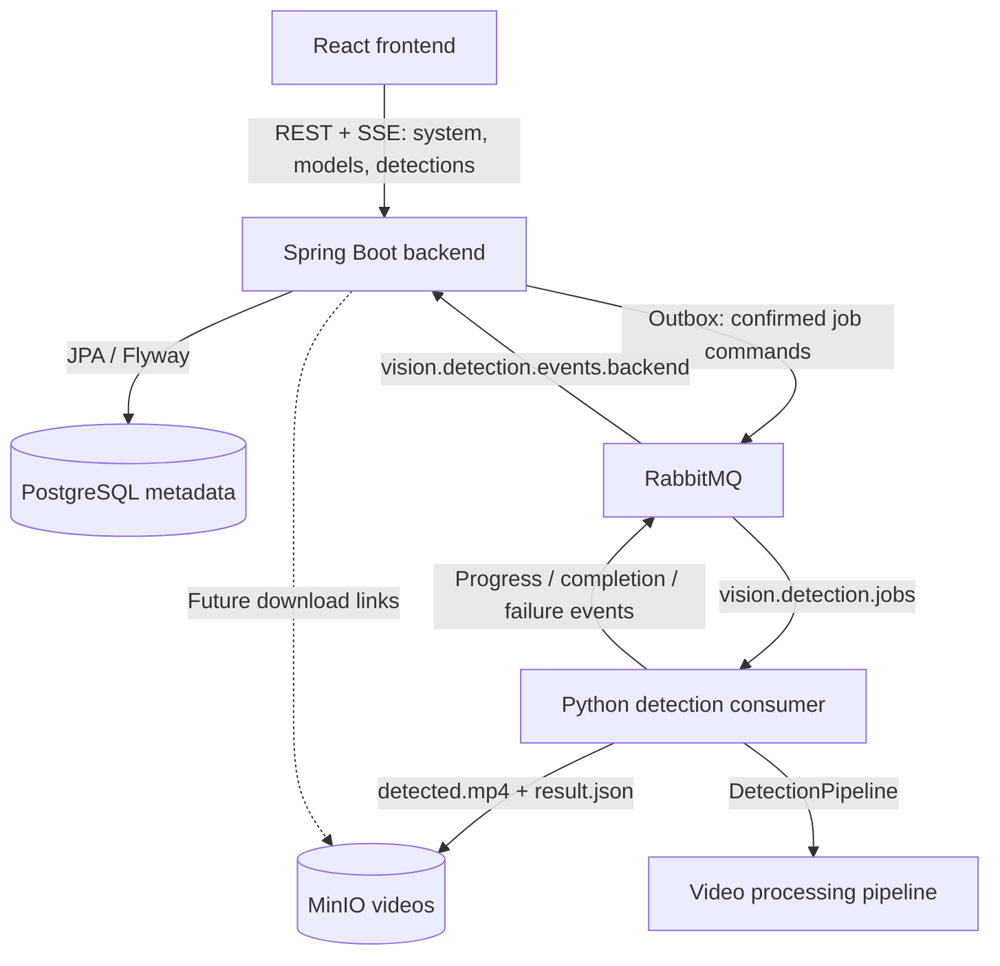

# Architecture

YOLO Vision Studio separates the browser application, API and metadata service, and Python processing service. Vehicle detection is the initial use case; later domain contracts should support any permitted detection classes and model families.

## Service boundaries



Solid arrows describe current integrations; dashed arrows describe later phases. Since Phase 05, the backend and the worker communicate only through RabbitMQ: there is no worker HTTP client and no synchronous inference. The FastAPI health service is unchanged and loads no AI libraries at startup. The separate consumer process loads a model only when a job requires one. The worker stores job artifacts in MinIO; the backend records only their object keys. See [asynchronous-job-processing.md](asynchronous-job-processing.md).

| Component | Responsibilities |
| --- | --- |
| Frontend | Navigation, presentation, backend status, and future job interaction |
| Backend | REST APIs (system, models, detections), SSE progress, validation, problem-detail errors, CORS, persistence, migrations, outbox publication, event-driven job lifecycle |
| AI worker | Health service, CLI, and a RabbitMQ consumer that runs the detection engine and stores artifacts |
| PostgreSQL | Backend metadata and Flyway migration history |
| RabbitMQ | Durable quorum queues for job commands and worker events, with dead-lettering |
| MinIO | Private storage for completed job artifacts (`detections/<jobId>/…`) |

The frontend communicates only with Spring Boot. Python inference must never run inside Spring Boot. Neither media files nor downloaded model weights belong in PostgreSQL or Git. Services exchange metadata and object references when those contracts are introduced.

## Backend

`com.yolovision` contains `controller`, `service`, `repository`, `entity`, `dto`, `config`, and `exception` packages. Controllers expose DTOs; services provide behavior through constructor injection. Phase 02 adds `ModelConfig`, `DetectionJob`, and `DetectionResult` entities, Spring Data repositories, string-based job statuses, and record response DTO foundations. No detection controller or processing service is introduced. Phase 04 adds the read-only `ModelController` and `ModelCatalogService` for the model catalog.

Spring Boot configures PostgreSQL, RabbitMQ, Flyway, health probes, and CORS from environment variables. Hibernate validates production schemas instead of modifying them. The unchanged V1 foundation is followed by V2-V5 migrations for model metadata, jobs, results, and the disabled `yolo26s` seed. V6 registers the remaining approved detection checkpoints, all disabled, without modifying existing rows. Jobs reference models restrictively; results reference one owning job and are removed with its metadata when the job is deleted. UUIDs, TIMESTAMPTZ, JSONB, relational constraints, and indexes support future processing without executing it. See [database-design.md](database-design.md) for the ER diagram, columns, query methods, and separate H2/PostgreSQL test strategies.

The global exception handler returns HTTP Problem Details and validation information without exposing internal exception messages or stack traces. Actuator exposes `health` and `info`; health details are hidden. Liveness indicates the application process is running. Readiness includes database and RabbitMQ availability, so dependency outages can produce a non-success health response even while the system information endpoint still responds.

## Frontend

React functional components use TypeScript strict mode, reusable navigation/status components, and a separate Axios API layer. React Router supplies Dashboard, Detection, History, and Models routes. The application shell maintains backend status across routes; the dashboard shows connection details. Feature routes identify planned work without pretending it is implemented.

The API client defaults to `/api/v1`. Vite proxies `/api` to Spring Boot, keeping browser traffic on the frontend origin during development. `VITE_PROXY_TARGET` selects the backend target used by the Vite process. The browser displays loading, successful connection, and error states based on actual responses; it offers retry after failure. No detection counts or availability claims are fabricated.

`VITE_API_BASE_URL` can override the browser API base URL for a different hosting setup. Values with a `VITE_` prefix are public browser configuration and must never contain credentials.

## AI worker

The worker uses FastAPI with API, services, workers, config, and schemas packages. Pydantic validates process settings. `python -m app` starts Uvicorn with the configured host, port, and JSON logging. Startup does not require PostgreSQL, RabbitMQ, MinIO, CUDA, model weights, or the optional AI Python dependencies.

Phase 03 adds `DetectionPipeline`, lazy cached YOLO26s loading, streamed frame inference, progress callbacks, bounded source handling, FFmpeg export, and JSON statistics. The library and CLI run independently of FastAPI and a broker. Counts describe bounding-box detection events across frames, not unique objects. Database model availability is not changed by local CLI support. See [ai-detection-engine.md](ai-detection-engine.md) for module boundaries and configuration.

Phase 04 replaces the single-model allowlist with `model_registry.py`, which lists the 20 approved detection checkpoints. Consistency tests keep it equal to the Flyway catalog. The worker reports cache and verification status per runtime through its CLI. PostgreSQL remains authoritative for catalog membership and enablement. See [yolo-model-management.md](yolo-model-management.md).

`/health` verifies that the worker HTTP process can serve requests. It does not claim that model weights, queue consumers, or an inference execution are ready. There is no public synchronous inference endpoint.

## Current API contracts

`GET /api/v1/system/info`, served by Spring Boot:

```json
{
  "application": "YOLO Vision Studio",
  "service": "backend",
  "version": "1.0.0",
  "status": "UP"
}
```

`GET /health`, served by the internal Python service:

```json
{
  "service": "ai-worker",
  "status": "UP"
}
```

Read-only model catalog, served by Spring Boot from PostgreSQL (works while the worker is offline): `GET /api/v1/models` (optional `version`, `size`, `enabled` filters), `GET /api/v1/models/versions`, and `GET /api/v1/models/{modelKey}`. See [yolo-model-management.md](yolo-model-management.md#5-spring-boot-rest-api-read-only) for response shapes and errors.

The backend also exposes `/actuator/health`, `/actuator/health/liveness`, and `/actuator/health/readiness`. Detection job APIs (Phase 06): `POST /api/v1/detections` (202), `GET /api/v1/detections` (paged history), `GET /api/v1/detections/{jobId}`, `GET /api/v1/detections/{jobId}/result`, and the SSE stream `GET /api/v1/detections/{jobId}/events`. SSE reads persisted state through one shared poller, so RabbitMQ stays internal. All errors are RFC 9457 problems with a stable `code`. See [detection-rest-api.md](detection-rest-api.md). OpenAPI is served at `/api/v1/openapi`. Video download contracts belong to later phases. The RabbitMQ message contracts (schema version 1) are documented in [asynchronous-job-processing.md](asynchronous-job-processing.md#3-message-contracts-schema-version-1).

## Deployment and persistence

Compose defines one dedicated bridge network and named volumes for PostgreSQL, RabbitMQ, and MinIO. Health checks gate dependent service startup. Published development ports bind to localhost; internal service discovery uses Compose names such as `postgres`, `rabbitmq`, and `backend`.

Runtime settings use environment variables. Required local credentials are supplied through the ignored root `.env`; `.env.example` contains no working passwords. The stack is a development foundation with no application authentication. A later deployment phase must define its environment-specific access and operational configuration before public hosting.
