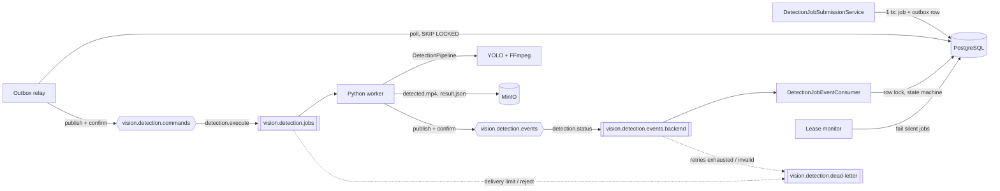

# Asynchronous detection job processing

Phase 05 runs detection jobs asynchronously:

- **Spring Boot** creates and tracks jobs in PostgreSQL and publishes execution commands through a transactional outbox.
- **The Python worker** consumes commands from RabbitMQ, runs the existing `DetectionPipeline`, stores the results in MinIO, and publishes progress, completion, and failure events.
- **Spring Boot** applies those events to PostgreSQL through a single, idempotent state machine.

Inference never runs in Spring Boot, and HTTP request threads never wait for it. Python never touches PostgreSQL.

There is still no public job API. Submission is an internal service (`DetectionJobSubmissionService`) until Phase 06. For development, the explicit `dev-harness` profile submits one job at startup (§16).

## 1. Architecture



## 2. Topology

Both sides declare identical entities. Spring declares them in `RabbitConfiguration`; the worker declares them in `rabbitmq_worker.declare_topology`. Either service can start first, and RabbitMQ refuses a redeclaration whose arguments differ.

| Entity | Name (default) | Properties |
| --- | --- | --- |
| Command exchange | `vision.detection.commands` | direct, durable |
| Command queue | `vision.detection.jobs` ← `detection.execute` | durable **quorum** queue, `x-delivery-limit`, dead-letter exchange and routing key |
| Event exchange | `vision.detection.events` | direct, durable |
| Event queue | `vision.detection.events.backend` ← `detection.status` | durable quorum queue, same delivery limit and dead-lettering |
| Dead-letter exchange | `vision.detection.dead-letter.exchange` | direct, durable |
| Dead-letter queue | `vision.detection.dead-letter` ← `detection.dead-letter` | durable quorum queue |

Quorum queues let the broker enforce a redelivery bound (`RABBITMQ_DELIVERY_LIMIT`, default 5), so a poison message can never loop forever. All messages are persistent, both publishers use confirms, and both publish with `mandatory`, so an unroutable message counts as a failure rather than a silent drop. Every name is configurable through the shared `RABBITMQ_*` variables (§14).

## 3. Message contracts (schema version 1)

JSON uses camelCase. The contract is mirrored by the Java records in `dto/messaging` and the Pydantic models in `app/schemas/messaging.py`, and both sides reject unknown schema versions.

**Command** (backend → worker). The AMQP `message_id` is the outbox id, and `correlation_id` is the job id.

```json
{"schemaVersion":1,"messageId":"uuid","jobId":"uuid","modelKey":"yolo11n",
 "sourceType":"YOUTUBE_URL","source":"https://www.youtube.com/watch?v=abcdefghijk",
 "confidence":0.250,"imageSize":960,"classes":[1,2,3,5,7],"createdAt":"2026-11-08T10:36:44.123Z"}
```

| Field | Rule |
| --- | --- |
| `modelKey` | Approved registry key; never a path |
| `sourceType` | `YOUTUBE_URL` or `LOCAL_FILE` |
| `source` | For `LOCAL_FILE`: a relative path inside the worker's `AI_LOCAL_INPUT_DIR` (letters, digits, `._-/`, no `.`/`..` segments). For YouTube: the worker revalidates and canonicalises the URL |
| `confidence` | 0–1, at most 3 decimals |
| `imageSize` | 32–4096 and a multiple of 32 |
| `classes` | 1–100 unique non-negative integers, validated against the loaded model's own class names |

Commands never carry credentials or checkpoint locations.

**Event** (worker → backend). It has one shape; `status` is one of `DOWNLOADING|DETECTING|ENCODING|UPLOADING|COMPLETED|FAILED`.

```json
{"schemaVersion":1,"eventId":"uuid","jobId":"uuid","status":"DETECTING","progress":65,
 "processedFrames":3250,"totalFrames":5000,"message":"Processing video frames","timestamp":"2026-11-08T10:37:00Z"}
```

- `COMPLETED` requires `progress: 100`, `modelKey`, and `result: {outputVideoKey, resultJsonKey, totalFrames, processingTimeMs, detectionSummary}`.
- `FAILED` requires `error: {code, message, retryable}`.
- Other statuses may carry neither, and may not report 100%.
- Event messages never contain local paths. The worker redacts paths and URLs from any engine text.

## 4. Command flow

1. `DetectionJobSubmissionService.submit` validates the configuration (Bean Validation plus stride, duplicate-class, URL, and path rules). It checks that the model is registered, is a `DETECT` model, and is **administratively enabled**. It then inserts the `PENDING` job and its outbox row **in one transaction**. Nothing is sent to RabbitMQ inside that transaction.
2. `DetectionOutboxRelay` polls every `OUTBOX_POLL_INTERVAL` (1 s). It locks due rows with `FOR UPDATE SKIP LOCKED`, so several backend instances never publish the same row together.
3. `DetectionCommandPublisher` sends with a correlated publisher confirm and treats a broker return as a failure. A row is `PUBLISHED`, and its job becomes `QUEUED`, only after an ack.
4. A failed publication keeps the row `PENDING` with exponential backoff (2 s doubling, capped at 5 min). After `OUTBOX_MAX_ATTEMPTS` (10) failures the row becomes `FAILED` and the job is failed with `PUBLICATION_FAILED`.

## 5. Event flow

`DetectionJobEventConsumer` (`@RabbitListener`, AUTO acknowledge mode) parses and validates each event. It calls `DetectionJobLifecycleService.apply`, which runs one transaction that locks the job row (`SELECT … FOR UPDATE`). The message is acknowledged only after that transaction commits.

## 6. Job lifecycle

```
PENDING → QUEUED → DOWNLOADING → DETECTING → ENCODING → UPLOADING → COMPLETED
                          any non-terminal state → FAILED            (CANCELLED: reserved, respected)
```

- `QUEUED` is set only by a confirmed publication.
- Stages move forward only. An event for an earlier stage is ignored as `STALE`.
- Progress never decreases and stays at or below 99 until `COMPLETED` (100).
- `COMPLETED`, `FAILED`, and `CANCELLED` are terminal. Later events for a terminal job are acknowledged and ignored (`DUPLICATE` or `IGNORED_TERMINAL`). This phase never sets `CANCELLED`, but it is never overwritten.
- `startedAt` is set by the first worker event, and `completedAt` by the terminal transition.

## 7. Progress updates

The worker converts the Phase 03 `ProgressReporter` callbacks into events. It does not use a second progress system.

| Pipeline stage | Job progress |
| --- | --- |
| Pipeline stages | Capped at 95 |
| `UPLOADING` | 96 |
| `COMPLETED` | 100, only after storage |

The pipeline's own `COMPLETED` stage is never forwarded.

Events are throttled. One is published on a stage change, when progress rises by `WORKER_PROGRESS_MIN_STEP` (5) points, or when `WORKER_PROGRESS_INTERVAL_SECONDS` (5) has passed and progress has increased. That avoids one message per frame.

A heartbeat thread also re-publishes the latest state every `WORKER_HEARTBEAT_SECONDS` (30). The backend records an unchanged event as a `HEARTBEAT` that refreshes `updated_at`.

## 8. Completion

1. The worker runs the pipeline with outputs in a per-job temporary directory.
2. It checks that the loaded model matches the command.
3. It publishes `UPLOADING`, then uploads `detected.mp4` followed by `result.json`, checking each upload's size by reading it back.
4. Only then does it publish `COMPLETED`, with the actual statistics taken from the stored manifest.

The backend then:

- verifies that `modelKey` equals the job's model. A mismatch fails the job with `MODEL_MISMATCH` and stores no result.
- inserts one `DetectionResult` with `output_video_key`, `result_json_key`, `total_frames`, `processing_time_ms`, and the JSONB `detection_summary`. The insert happens only if none exists; the unique `job_id` constraint is the final guard.
- marks the job `COMPLETED` with progress 100.

## 9. Failure handling

| Kind | Examples (error code) | Worker action |
| --- | --- | --- |
| Invalid command | Malformed JSON, unknown schema version, bad fields (`INVALID_COMMAND`) | Publish `FAILED` if a job id is readable, then reject to the DLQ |
| Permanent | `UNSUPPORTED_MODEL`, `MODEL_NOT_PREPARED`, `INVALID_SOURCE`, `VIDEO_LIMIT_EXCEEDED`, `INFERENCE_FAILED`, `VIDEO_PROCESSING_FAILED`, `VIDEO_ENCODING_FAILED` | Publish `FAILED` once and acknowledge |
| Transient | `VIDEO_DOWNLOAD_FAILED`, `MODEL_LOAD_FAILED`, `STORAGE_FAILED`, `EVENT_PUBLICATION_FAILED`, `INTERNAL_ERROR` | Requeue with backoff until `JOB_MAX_RETRIES`; then publish `FAILED` ("Gave up after N attempt(s)") and reject to the DLQ |

Error messages are short and sanitised. FFmpeg diagnostics and unexpected exceptions are replaced with fixed text, and no tracebacks are sent. The backend strips control characters and caps the message at 1000 characters.

On the backend:

- Malformed events, invalid events, and events for unknown jobs are dead-lettered immediately and not retried.
- Other failures, such as a database outage, are retried 3 times in the listener (1 s, 2 s, 4 s) and then dead-lettered.

## 10. Retry policy

| Layer | Bound |
| --- | --- |
| Outbox publication | `OUTBOX_MAX_ATTEMPTS` (10), exponential backoff up to `OUTBOX_MAX_BACKOFF` (5 min) |
| Worker transient errors | `JOB_MAX_RETRIES` (3) attempts in total. The attempt number comes from the broker's `x-delivery-count`, so it survives worker restarts. Backoff is `WORKER_RETRY_BACKOFF_SECONDS × 2^(attempt−1)`, capped at 300 s, while the job holds its prefetch slot |
| Broker safety net | `RABBITMQ_DELIVERY_LIMIT` (5) redeliveries, after which RabbitMQ dead-letters the message. This also bounds crash loops: validation showed that a consumer killed mid-job increments the count. Keep this value above `JOB_MAX_RETRIES` |
| Event listener | `RABBITMQ_EVENT_MAX_ATTEMPTS` (3) |

## 11. Dead-letter behaviour

The work queues dead-letter to `vision.detection.dead-letter` in these cases:

- the worker rejects a command (invalid, or retries exhausted)
- the backend rejects an event (invalid, unknown job, or retries exhausted)
- the broker's delivery limit is reached

RabbitMQ's `x-death` header records the original queue and reason. Nothing consumes the DLQ automatically. Inspect it in the management UI (`http://localhost:15672`) and replay or discard messages manually after fixing the cause.

## 12. Idempotency

Delivery is **at least once**; exactly-once is not claimed.

| Duplicate | Why it is safe |
| --- | --- |
| Republished command (outbox retry after a lost commit, or a manual replay) | The worker first checks MinIO for this job's `result.json`, which is written last. If it is present, the worker republishes `COMPLETED` from it without running inference again. Object keys are deterministic per job, so a rerun overwrites only that job's own objects |
| Duplicate or reordered progress | Forward-only stages and monotonic progress, applied under a row lock |
| Duplicate completion | Same terminal state means `DUPLICATE`, with no second result. The result is inserted only if missing, backed by the unique constraint |
| Late events after a terminal state | Ignored |
| Backend restart | Unpublished outbox rows are retried. Unacknowledged events are redelivered |
| Worker crash | The command is unacknowledged, so the broker redelivers it to the next worker |

The command's `messageId` and the event's `eventId` are stable identifiers for tracing. Deduplication is based on job state and stored artifacts, not on an in-memory set.

## 13. Transactional outbox

`detection_job_outbox` (Flyway `V7__detection_job_messaging.sql`) has these columns:

- `id` (= AMQP message id)
- `job_id` (FK, cascade)
- `message_type`
- `payload` (JSONB object)
- `status` (`PENDING`/`PUBLISHED`/`FAILED`)
- `attempts`, `next_attempt_at`, `last_error`, `created_at`, `published_at`

A unique `(job_id, message_type)` index allows one execution command per job, and a partial index serves due `PENDING` rows. V7 also adds these columns:

| Table | Column | Notes |
| --- | --- | --- |
| `detection_jobs` | `source_type` | Existing rows default to `YOUTUBE_URL`; checked |
| `detection_jobs` | `error_code` | |
| `detection_results` | `result_json_key` | |

## 14. Configuration

Spring Boot, the worker, and Compose read the same variables. Change topology names together.

| Variable | Default | Used by |
| --- | --- | --- |
| `RABBITMQ_COMMAND_EXCHANGE` / `_QUEUE` / `_ROUTING_KEY` | `vision.detection.commands` / `vision.detection.jobs` / `detection.execute` | Both |
| `RABBITMQ_EVENT_EXCHANGE` / `_QUEUE` / `_ROUTING_KEY` | `vision.detection.events` / `vision.detection.events.backend` / `detection.status` | Both |
| `RABBITMQ_DEAD_LETTER_EXCHANGE` / `_QUEUE` / `_ROUTING_KEY` | `vision.detection.dead-letter.exchange` / `vision.detection.dead-letter` / `detection.dead-letter` | Both |
| `RABBITMQ_DELIVERY_LIMIT` | 5 | Both (queue argument) |
| `WORKER_CONCURRENCY`, `WORKER_PREFETCH_COUNT` | 1, 1 | Worker. One inference per process. Prefetch is never below concurrency |
| `JOB_MAX_RETRIES`, `WORKER_RETRY_BACKOFF_SECONDS` | 3, 5 | Worker |
| `WORKER_PROGRESS_MIN_STEP`, `WORKER_PROGRESS_INTERVAL_SECONDS`, `WORKER_HEARTBEAT_SECONDS` | 5, 5, 30 | Worker |
| `WORKER_ALLOW_MODEL_DOWNLOAD` | `false` | Worker. When false, an unprepared model fails with `MODEL_NOT_PREPARED` |
| `WORKER_SHUTDOWN_TIMEOUT_SECONDS`, `WORKER_HEALTH_FILE`, `RABBITMQ_HEARTBEAT_SECONDS` | 60, unset, 60 | Worker |
| `OUTBOX_POLL_INTERVAL`, `OUTBOX_MAX_ATTEMPTS`, `OUTBOX_CONFIRM_TIMEOUT` | 1s, 10, 10s | Backend |
| `JOB_PROCESSING_TIMEOUT_SECONDS`, `JOB_QUEUE_TIMEOUT_SECONDS`, `JOB_LEASE_CHECK_INTERVAL` | 1800, 86400, 60s | Backend |

Inside Docker, services use `postgres:5432`, `rabbitmq:5672`, and `minio:9000`. Host ports such as `POSTGRES_PORT=15432` and `BACKEND_PORT=18080` affect only the published ports.

## 15. MinIO artifact storage

The worker writes to bucket `MINIO_BUCKET` (default `videos`):

- `detections/<jobId>/detected.mp4` (`video/mp4`)
- `detections/<jobId>/result.json` (`application/json`)

A missing bucket is created private, and no public policy is ever applied. The manifest contains the measured input metadata, statistics, model and device, and the two object keys, but no local paths.

The backend stores only the keys. Download links and delivery belong to Phase 09. Credentials come from `MINIO_ACCESS_KEY`/`MINIO_SECRET_KEY` and never appear in messages.

## 16. Local development

```powershell
# Worker (from ai-worker/, existing venv with requirements-ai.txt installed)
$env:RABBITMQ_PASSWORD='...'; $env:MINIO_SECRET_KEY='...'
$env:AI_LOCAL_INPUT_DIR='inputs'; $env:AI_FFMPEG_PATH='C:\Tools\ffmpeg\bin\ffmpeg.exe'  # only if not on PATH
.\.venv\Scripts\python.exe -m app.workers.rabbitmq_worker

# Prepare and enable a model first (the worker never downloads weights by default)
.\.venv\Scripts\python.exe -m app.cli models prepare --model yolo11n --device cpu
#   SQL: UPDATE model_configs SET enabled = TRUE WHERE model_key = 'yolo11n';

# Submit one job through the real service (development only; never enables models)
$env:SPRING_PROFILES_ACTIVE='dev-harness'; $env:HARNESS_MODEL_KEY='yolo11n'
$env:HARNESS_SOURCE_TYPE='LOCAL_FILE'; $env:HARNESS_SOURCE='clip.mp4'; $env:HARNESS_IMAGE_SIZE='320'
java -jar backend\target\backend-1.0.0.jar
```

## 17. Docker Compose

Compose runs two processes from the worker image:

| Service | Runs | Health |
| --- | --- | --- |
| `ai-worker` | Unchanged FastAPI `/health` | HTTP `/health` |
| `ai-detection-consumer` | `python -m app.workers.rabbitmq_worker` | A heartbeat file updated every 5 s while connected (the image's HTTP healthcheck is overridden) |

Both services share the `ai-model-cache` volume, which must be prepared inside Docker. Weights on the Windows host are not visible there:

```powershell
docker compose up -d --build backend ai-detection-consumer
docker compose exec ai-detection-consumer python -m app.cli models prepare --model yolo11n --device cpu
```

`LOCAL_FILE` jobs need an input volume mounted at `/data/inputs`; none is mounted by default. `stop_grace_period` (90 s) leaves time for graceful shutdown. On SIGTERM the consumer:

1. stops consuming
2. finishes running jobs for up to `WORKER_SHUTDOWN_TIMEOUT_SECONDS`
3. acknowledges them
4. closes the connection

Any job still running after that is redelivered to the next consumer.

## 18. Integration testing

| Suite | Command | Infrastructure |
| --- | --- | --- |
| Backend unit + H2 | `mvn -B test` | None (listeners and schedulers off) |
| Backend PostgreSQL + RabbitMQ | `mvn -B -Ppostgres-it verify` | Docker (Testcontainers PostgreSQL 17 and RabbitMQ 4.2) |
| Worker unit | `python -m pytest -q` | None. Fake pika connection, fake MinIO, fake pipeline |
| Worker ↔ real broker and MinIO | `IT_RABBITMQ_HOST=… IT_RABBITMQ_PORT=… IT_RABBITMQ_PASSWORD=… IT_MINIO_ENDPOINT=… IT_MINIO_PASSWORD=… python -m pytest -q tests/integration` | Disposable RabbitMQ and MinIO |

Recorded results, including the real end-to-end run, are in [phase-05-validation.md](phase-05-validation.md).

## 19. Troubleshooting

| Symptom | Cause / action |
| --- | --- |
| Job stays `PENDING` | The relay cannot publish (broker down or unroutable). Check `detection_job_outbox.last_error`. Retries continue with backoff and end in `PUBLICATION_FAILED` |
| Job stays `QUEUED` | No consumer, or all consumers busy. Check `rabbitmqctl list_queues name messages consumers`. After `JOB_QUEUE_TIMEOUT_SECONDS` the job fails with `QUEUE_TIMEOUT` |
| `FAILED` / `MODEL_NOT_PREPARED` | Prepare the model in *that* worker's cache (`models prepare`), or set `WORKER_ALLOW_MODEL_DOWNLOAD=true` |
| `FAILED` / `PROCESSING_TIMEOUT` | The worker sent no event (not even a heartbeat) for `JOB_PROCESSING_TIMEOUT_SECONDS`, for example because it crashed. A redelivered command may still run afterwards, but its events are ignored because the job is terminal |
| `PRECONDITION_FAILED … inequivalent arg` at startup | Backend and worker topology settings differ, or a queue was created earlier with other arguments. Align the variables, or delete the queue (losing its messages) |
| Messages in `vision.detection.dead-letter` | Inspect the `x-death` header and the services' logs |
| `ACCESS_REFUSED` | Wrong `RABBITMQ_USERNAME`/`RABBITMQ_PASSWORD` |
| Upload errors (`STORAGE_FAILED`) | Check `MINIO_ENDPOINT` and credentials. Retries are bounded |

## 20. Known limitations

- **At-least-once execution.** If the backend commits fail after a confirmed publish, or with several workers and a republished command, the same job can run twice concurrently. Deterministic object keys and the backend's idempotent completion keep the final state correct; only compute is wasted. There is no cross-worker execution lease.
- **Hard kills leave temporary files.** SIGKILL or a power loss leaves the job's temporary directory under `AI_TEMP_DIR`, and nothing cleans it automatically.
- **Disconnect stalls new work.** When the broker connection drops, the worker lets running jobs finish before reconnecting. Their acknowledgements are lost, so the commands are redelivered and answered from stored artifacts.
- **Terminal failures are final.** A job failed by the lease monitor is not revived by a late completion; its stored artifacts remain in MinIO.
- **No DLQ automation.** The dead-letter queue has no consumer and no replay tooling.
- **Not yet built:** cancellation, a public job API, and download links.
