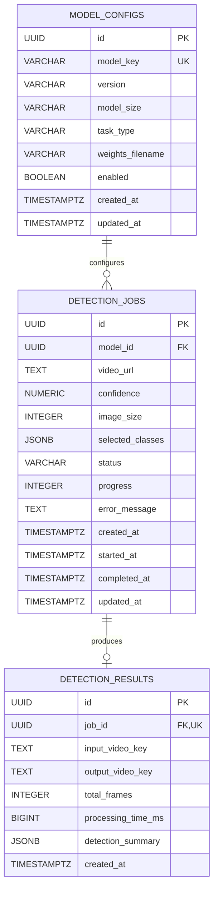

# Database design

## Overview

Phase 02 adds PostgreSQL persistence for model metadata, video detection job configuration and state, and result metadata. Spring Boot owns these records. Video bytes and model weights remain outside the database; future processing will exchange job IDs and object storage keys with the Python worker.

The production database is PostgreSQL 17. Flyway creates and evolves its schema, and Hibernate uses `ddl-auto: validate`. Phase 02 provides no detection REST endpoints, processing orchestration, RabbitMQ consumers, inference, or MinIO transfer code.

## Entity relationships



Each job references exactly one model configuration. A model can have any number of jobs. A job can have zero or one result; every result belongs to one job.

## Tables and columns

### `model_configs`

Model metadata uses `model_key` as its stable business identifier. `enabled` describes availability for selection; metadata alone does not mean a model is installed or supported by the worker.

| Column | PostgreSQL type | Nullability and purpose |
| --- | --- | --- |
| `id` | `UUID` | Required primary key; database default `gen_random_uuid()` |
| `model_key` | `VARCHAR(64)` | Required, unique stable identifier |
| `version` | `VARCHAR(32)` | Required model family/version label |
| `model_size` | `VARCHAR(16)` | Required size label; not restricted to one model family |
| `task_type` | `VARCHAR(32)` | Required task label such as `DETECT` |
| `weights_filename` | `VARCHAR(255)` | Required weights filename, not a hardcoded machine path |
| `enabled` | `BOOLEAN` | Required; defaults to `FALSE` |
| `created_at` | `TIMESTAMPTZ` | Required creation instant; defaults to `CURRENT_TIMESTAMP` |
| `updated_at` | `TIMESTAMPTZ` | Required last update instant; defaults to `CURRENT_TIMESTAMP` |

The initial Flyway seed registers `yolo26s`, version `YOLO26`, size `s`, task `DETECT`, and filename `yolo26s.pt`, with `enabled = false`. No weights are downloaded, installed, or loaded. Additional models can be introduced through later migrations or future catalog workflows.

### `detection_jobs`

This table records requested detection settings and processing metadata. It does not start work by itself.

| Column | PostgreSQL type | Nullability and purpose |
| --- | --- | --- |
| `id` | `UUID` | Required primary key; database default `gen_random_uuid()` |
| `model_id` | `UUID` | Required foreign key to `model_configs.id` |
| `video_url` | `TEXT` | Required source video URL |
| `confidence` | `NUMERIC(4,3)` | Required confidence between `0.000` and `1.000`, inclusive |
| `image_size` | `INTEGER` | Required positive image dimension |
| `selected_classes` | `JSONB` | Required JSON array of class identifiers |
| `status` | `VARCHAR(32)` | Required supported job status; defaults to `PENDING` |
| `progress` | `INTEGER` | Required percentage from 0 through 100; defaults to 0 |
| `error_message` | `TEXT` | Optional processing failure detail |
| `created_at` | `TIMESTAMPTZ` | Required creation instant; defaults to `CURRENT_TIMESTAMP` |
| `started_at` | `TIMESTAMPTZ` | Optional processing start instant |
| `completed_at` | `TIMESTAMPTZ` | Optional terminal processing instant |
| `updated_at` | `TIMESTAMPTZ` | Required last update instant; defaults to `CURRENT_TIMESTAMP` |

Selected classes use `List<Integer>` in Java and JSONB in PostgreSQL, for example `[1, 2, 3, 5, 7]`. These sample COCO identifiers correspond to bicycle, car, motorcycle, bus, and truck. The schema supports other class identifiers and does not constrain the application to vehicles. Future model-specific class catalogs must define which identifiers are valid for each model.

### `detection_results`

Results contain storage references and detection statistics. A database row does not create or delete an object in MinIO.

| Column | PostgreSQL type | Nullability and purpose |
| --- | --- | --- |
| `id` | `UUID` | Required primary key; database default `gen_random_uuid()` |
| `job_id` | `UUID` | Required, unique foreign key to `detection_jobs.id` |
| `input_video_key` | `TEXT` | Optional input video object key |
| `output_video_key` | `TEXT` | Required processed video object key |
| `total_frames` | `INTEGER` | Optional nonnegative frame count |
| `processing_time_ms` | `BIGINT` | Optional nonnegative elapsed processing time |
| `detection_summary` | `JSONB` | Required JSON object containing detection statistics |
| `created_at` | `TIMESTAMPTZ` | Required creation instant; defaults to `CURRENT_TIMESTAMP` |

The summary maps class names to detection totals using `Map<String, Long>`, for example `{"car": 120, "motorcycle": 45}`. These are detections, not unique vehicles or unique tracked objects. A single object appearing in many frames can contribute many detections. Unique object counting requires tracking in a future phase.

## Referential integrity and constraints

- `detection_jobs.model_id` references `model_configs.id` with restrictive deletion. A referenced model cannot be removed; disabling it preserves historical jobs.
- `detection_results.job_id` references `detection_jobs.id` with `ON DELETE CASCADE`. Deleting a job removes its result metadata, while physical video objects remain untouched.
- Unique constraints enforce one row per model key and at most one result per job.
- Required columns use `NOT NULL` and IDs use native UUID primary keys.
- CHECK constraints enforce confidence in `[0, 1]`, progress in `[0, 100]`, positive image size, supported status strings, nonnegative optional frame counts and processing time, an array-shaped `selected_classes`, and an object-shaped `detection_summary`.

JSONB shape checks do not replace model-specific class validation or a future statistics contract. Java Bean Validation adds checks to entity values, including nonnegative class identifiers and summary counts. Direct SQL writes must still respect the database constraints and maintain timestamps explicitly.

## Indexes

| Index / unique constraint | Indexed columns | Purpose |
| --- | --- | --- |
| `uk_model_configs_model_key` | Unique `model_key` | Stable key lookup and duplicate prevention |
| `idx_detection_jobs_status` | `status` | Status-based job lookup |
| `idx_detection_jobs_created_at` | `created_at DESC`, `id DESC` | Recent job queries with stable ordering |
| `idx_detection_jobs_model_id` | `model_id` | Model-specific history and foreign key access |
| `idx_detection_jobs_status_created_at` | `status`, `created_at DESC`, `id DESC` | Status filtering with creation-time ordering |
| `uk_detection_results_job_id` | Unique `job_id` | Result lookup and one-result-per-job enforcement |

PostgreSQL creates indexes for primary keys and unique constraints automatically. Those indexes are not recreated as redundant standalone indexes. JSONB GIN indexes are omitted because Phase 02 does not introduce queries inside JSON documents.

## Flyway migrations

All production migrations are in `backend/src/main/resources/db/migration/`:

| Migration | Purpose |
| --- | --- |
| `V1__foundation.sql` | Existing Phase 01 baseline; preserved unchanged |
| `V2__create_model_configs.sql` | Model metadata table and unique model key |
| `V3__create_detection_jobs.sql` | Job table, model reference, constraints, and query indexes |
| `V4__create_detection_results.sql` | Result table, owning job reference, uniqueness, and statistics metadata |
| `V5__seed_initial_model_configs.sql` | Disabled `yolo26s` metadata |
| `V6__seed_yolo_detection_model_catalog.sql` | The 20 approved detection checkpoints (YOLOv8, YOLO11, YOLO12, YOLO26 × n/s/m/l/x), all disabled, inserted with `ON CONFLICT (model_key) DO NOTHING` so existing rows are preserved ([details](yolo-model-management.md#4-postgresql-catalog)) |

Flyway applies migrations once in version order and records checksums in `flyway_schema_history`. Do not edit migrations that may have run in an existing environment. Add a later migration for schema or seed changes. The seed runs through Flyway, never through application startup code.

Production Flyway remains enabled, including the PostgreSQL database support dependency required by the installed Flyway version. Hibernate validates the migrated schema instead of creating or updating production tables. Migration ordering creates parent tables before their dependents; there are no destructive schema changes in Phase 02.

## JPA and DTO mapping

- `ModelConfig`, `DetectionJob`, and `DetectionResult` use Jakarta Persistence, generated UUID identifiers, explicit snake_case table/column names, and Java `Instant` timestamps.
- The database stores timestamps as `TIMESTAMPTZ`, representing instants rather than a machine's local wall clock. Hibernate's JDBC time zone is UTC. Persist and update callbacks maintain creation/update fields for JPA writes. Creation timestamps remain unchanged on updates; processing start/completion timestamps remain explicitly assignable. Database timestamp defaults initialize direct SQL inserts; there is no update trigger, so direct SQL updates must assign `updated_at` themselves.
- `confidence` uses `BigDecimal`, never floating point. Java `@Digits` rejects excess fractional precision for entity writes; PostgreSQL applies normal `NUMERIC(4,3)` rounding to direct SQL values before checking the stored range.
- `DetectionJobStatus` is persisted with `EnumType.STRING`. The database CHECK constraint uses the same status names; ordinals are never stored.
- Relationships are unidirectional and lazy. A job references its model; a result references its job. There are no inverse collections or cascading model deletion from JPA.
- Hibernate 6 `@JdbcTypeCode(SqlTypes.JSON)` maps selected class IDs and detection summaries to JSONB using the existing Jackson support. JSON is not manually assembled as strings.
- Repositories extend `JpaRepository<..., UUID>`. Derived queries provide model key/enabled lookup, pageable job queries by status/model/creation time, and result lookup/existence by job ID.
- `ModelConfigResponse`, `DetectionJobResponse`, and `DetectionResultResponse` are record DTO foundations. Relationship references are scalar IDs; DTOs do not expose JPA entity objects. No detection controller is introduced in this phase.

Creation-ordered repository methods use the UUID as a secondary sort key so equal timestamps do not produce unstable page ordering. A future transactional service can implement lifecycle transitions without changing the stored status representation.

## Job status definitions

| Status | Intended meaning |
| --- | --- |
| `PENDING` | Request is persisted; default initial state |
| `QUEUED` | Accepted for asynchronous execution |
| `DOWNLOADING` | Source video acquisition is in progress |
| `DETECTING` | Object detection is in progress |
| `ENCODING` | Annotated video encoding is in progress |
| `UPLOADING` | Result artifacts are being stored |
| `COMPLETED` | Processing finished successfully |
| `FAILED` | Processing failed |
| `CANCELLED` | Processing was cancelled |

These definitions establish persisted vocabulary only. Phase 02 does not enforce transition order, queue work, mark a model as supported by the worker, or require particular progress/timestamp combinations for each state. A later service must define those rules and concurrency behavior explicitly.

## Example records

The seeded model metadata is equivalent to:

```json
{
  "modelKey": "yolo26s",
  "version": "YOLO26",
  "modelSize": "s",
  "taskType": "DETECT",
  "weightsFilename": "yolo26s.pt",
  "enabled": false
}
```

A future job could persist `video_url = 'https://www.youtube.com/watch?v=example'`, `confidence = 0.350`, `image_size = 640`, `selected_classes = [1, 2, 3, 5, 7]`, `status = 'PENDING'`, and `progress = 0`. This example describes storage shape; it is not a currently executable request and does not make the disabled model available.

A future result could contain object keys such as `jobs/<job-id>/input.mp4` and `jobs/<job-id>/annotated.mp4`, `total_frames = 1800`, `processing_time_ms = 42000`, and `detection_summary = {"car": 120, "motorcycle": 45, "truck": 12, "bus": 8}`. Object keys are storage references, not hardcoded filesystem paths or presigned URLs.

## Local PostgreSQL setup

Use the existing root `.env`. If it does not exist, create it from `.env.example` and fill its blank password values with independently generated local credentials. Never overwrite an existing `.env`, commit credentials, or point tests at an unknown local database.

From the repository root:

```powershell
# Select a free published port if localhost:5432 belongs to another application.
$env:POSTGRES_PORT = '15432'
docker compose config --quiet
docker compose up -d postgres
docker compose ps postgres
```

This starts the project's PostgreSQL service with its dedicated named volume; it does not run Flyway until the backend connects. Configure the local backend with `DB_HOST=localhost`, the selected `DB_PORT`, and the intended `.env` database credentials, then run `backend/mvnw.cmd spring-boot:run`. The backend also expects its configured RabbitMQ dependency for readiness. See [development.md](development.md) for process environment setup and the rest of the stack.

`docker compose down` preserves named data. Do not delete volumes or reset a database to make a migration or test pass. Credentials already initialized in a persistent database are not rotated automatically by editing `.env`.

## Test strategy and commands

Run these commands from `backend/`:

```powershell
# Existing API tests plus fast entity/repository checks; no Docker required.
.\mvnw.cmd clean test

# Build the application and rerun available fast tests.
.\mvnw.cmd package

# Real PostgreSQL integration checks in an isolated Testcontainers database.
.\mvnw.cmd -Ppostgres-it verify
```

On macOS/Linux, replace `.\mvnw.cmd` with `./mvnw`.

The fast `test` profile is under test resources only. It uses an isolated H2 database in PostgreSQL compatibility mode, targets Flyway at the unchanged V1 foundation, and allows Hibernate to create/drop the entity mapping schema for this test database. It explicitly does not execute PostgreSQL migrations V2-V6. Fast tests verify repository behavior, JSON mapping, entity relationships, validation, timestamps, API compatibility, and the H2-generated constraints. They do not prove PostgreSQL compatibility or production schema correctness.

The `postgres-it` Maven profile runs the PostgreSQL integration suite using Testcontainers PostgreSQL 17. The suite creates its own ephemeral database on a dynamically assigned port, applies the real production migrations V1-V6, verifies the 20-model catalog and V5→V6 upgrade preservation, validates the schema through Hibernate, and tests JSONB persistence, relationships, queries, defaults, and PostgreSQL constraints. It does not use `.env` credentials or the unrelated database on localhost:5432. The Docker daemon must be running; first use may download container images.

An explicitly requested PostgreSQL test run fails when its required Docker infrastructure cannot be used. If Docker is unavailable, run the fast tests, report PostgreSQL integration validation as **NOT RUN**, and retain the command above for later execution. Never count unexecuted integration tests as passed. A successful Compose configuration check alone proves neither migration compatibility nor container startup.

### Phase 02 validation results

Validated on Windows on 2026-11-08 with Java 21, Spring Boot 3.5.16, H2 2.3.232, Testcontainers 1.21.4, and PostgreSQL 17.11:

| Check | Executed result |
| --- | --- |
| Fast tests | 32 passed: 11 existing API/error tests, 12 H2 repository tests, 9 Bean Validation cases |
| PostgreSQL integration tests | 35 passed using an isolated Testcontainers database; no failures, errors, or skips |
| Flyway and Hibernate validation | All five production migrations applied and validated; repeated migration execution applied zero changes |
| Maven packaging | `mvnw.cmd -B -DskipTests package` succeeded after the test suites had executed |
| Integration result verification | `mvnw.cmd -B -Ppostgres-it failsafe:verify` succeeded |
| Compose | Configuration validated; project PostgreSQL started healthy on `127.0.0.1:15432` |

The tests were executed during the clean Maven verification lifecycle. Surefire and Failsafe reports confirm all 67 test cases passed. Packaging did not rerun those tests. PostgreSQL verification is complete for this phase; H2 results are not used as a substitute for it. The unrelated PostgreSQL listener on port 5432 was not used or modified. RabbitMQ, MinIO transfers, and processing workflows remain outside this persistence phase.

## Future extensions

Later phases can add model catalogs and availability checks, transactional job services and REST APIs, worker message contracts, object storage integration, and progress events. Model/class validation must remain general-purpose. Queue delivery, idempotency, concurrency, retention, and deletion of physical video objects need explicit contracts before implementation. Tracking-based unique object counts require separate data and semantics; detection summaries must not be relabeled as unique counts.
