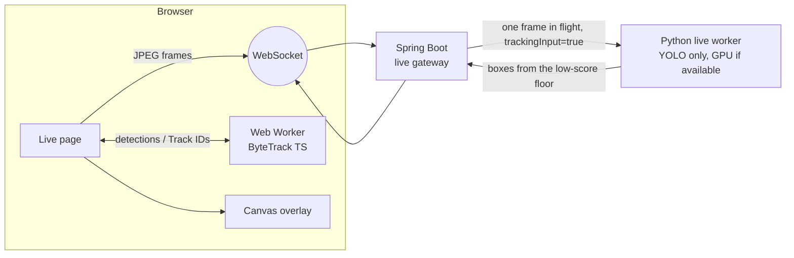
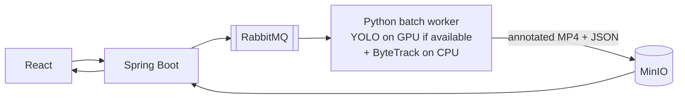

# Hybrid Tracking and GPU Acceleration

Branch `feature/hybrid-tracking-gpu`, based on `feature/quantization-frontend-integration` (`90abc58`).

**Status.**

- **CPU, verified end to end** in an isolated Docker stack and a real browser (§11):
  - Live Detection in all three modes: off, browser ByteTrack (CLIENT), server ByteTrack (SERVER);
  - YouTube jobs with and without Python ByteTrack;
  - OpenVINO INT8.
- **GPU (NVIDIA GTX 1650), verified** in the CUDA image:
  - live and batch YOLO on `cuda:0`;
  - INT8 kept on the CPU;
  - explicit `cuda:0` without CUDA is a clear error;
  - CPU vs GPU benchmark (§12).

## 1. Previous architecture

- **Live Detection:** browser → Spring Boot (WebSocket) → Python live worker. With tracking on, the live worker ran YOLO **and** ByteTrack per session and returned Track IDs.
- **YouTube / batch:** Spring Boot → RabbitMQ → Python worker: YOLO, optional ByteTrack, annotated MP4, then MinIO.
- **Devices:** CPU only in every image (PyTorch CPU wheels), OpenVINO INT8 optional on the CPU.

## 2. New hybrid architecture





**Where tracking runs**

| Path | Tracking |
| --- | --- |
| Live, tracking on (new default) | Browser: ByteTrack in a dedicated Web Worker; the live worker only detects |
| Live, "Track in: Server" | Live worker: ByteTrack per session (legacy path, kept) |
| YouTube / batch | Python worker: ByteTrack on the CPU (unchanged) |

**Spring Boot's role:** validation, session handling, backpressure and transport only. It runs no inference and no tracking.

## 3. Live Detection data flow (CLIENT tracking)

1. The page sends `start` with `tracking: true, trackingMode: "CLIENT"`, and receives `ready` with `trackingMode: "CLIENT"`.
2. Frames go out as binary WebSocket messages (`[uint32 frameId][JPEG]`), **one at a time**, never faster than the session rate (≤ 5 FPS), and paused while the tab is hidden. This backpressure already existed and is unchanged.
3. Spring Boot calls `/internal/live/infer?…&trackingInput=true`.
   - The live worker runs YOLO at ByteTrack's low-score floor, `min(confidence, 0.1)`, and returns **every** box.
   - Low-score boxes are needed for ByteTrack's second association stage. The worker attaches no Track IDs and keeps no tracking state.
4. The `detections` message carries:
   - `frameId`, `width`, `height`, `detections` (`classId`, `label`, `confidence`, `box`);
   - `inferenceMs`, `serverMs`;
   - `trackingMode: "CLIENT"`, `lowScoreFloor`;
   - `device` (`cpu` or `cuda:N`) and `precision` (`FP32` or `INT8`): what the worker actually ran.
5. The page releases the pipeline at once (the next frame can be captured) and posts the detections to the Web Worker, which assigns Track IDs (§8).
6. The tracked result is drawn on the canvas.
   - **Mapping:** `object-fit: contain` letterbox mapping, mirroring, and device-pixel-ratio sizing at draw time.
   - **Between results:** the last result is redrawn when the canvas is resized, the window is resized or zoomed (device pixel ratio), or the preview is mirrored.
   - **Ordering:** a result older than the one already drawn is never drawn.

**Per-frame and per-session fields.**

- **Per frame:** the `detections` message has `frameId`, the frame `width`/`height`, and each box's `classId`, `label`, `confidence` and `box`.
- **Per session:** `sessionId` and `modelKey` are sent once, in `ready`.
- **Timestamps:** the browser keeps each frame's send time by `frameId` and passes it to the tracker as `timestampMs`. The transport protocol is unchanged.

**Metrics shown:** each is labelled separately, and camera FPS is never presented as inference FPS.

| Tile | Meaning |
| --- | --- |
| Camera FPS | Frame rate the camera delivers (video track settings) |
| Sent FPS | Frames submitted per second |
| Processed FPS | Results received and handled per second |
| Rendered FPS | Overlay redraws for new results per second |
| Latency | Send to draw, including tracking |
| Round trip | Send to detections received |
| Inference | YOLO time reported by the worker |
| Tracking (browser) | Web Worker ByteTrack time |
| Device | The device the worker reported |

## 4. YouTube / batch data flow

Unchanged:

- **Download and validation:** limits, the job lifecycle, outbox, RabbitMQ, retries and the dead-letter queue.
- **Processing modes:** Detection Only and Detection + Tracking (Python ByteTrack on the CPU).
- **Output:** MP4 encoding, MinIO, results, downloads and SSE progress.

YOLO runs on the GPU when the GPU image is used and `AI_DEVICE=auto` finds CUDA. The device is reported with each result (`inferenceDevice`). Tracking and encoding are unaffected by the device.

## 5. GPU compatibility and setup

**Detected on the development host**

| Component | Value |
| --- | --- |
| CPU | AMD Ryzen 5 5600H (6 cores / 12 threads) |
| Discrete GPU | NVIDIA GeForce GTX 1650, 4 GB, compute capability 7.5, driver 616.56 (CUDA up to 13.4) |
| Integrated GPU | AMD Radeon (not used: no supported YOLO/PyTorch GPU runtime was set up for it) |
| Docker GPU | Docker Desktop (WSL2) with the `nvidia` runtime; `nvidia-smi` inside a container lists the GTX 1650 |
| PyTorch | Project images ship CPU-only `torch 2.13.0+cpu`. `torch 2.13.0+cu126` / `torchvision 0.28.0+cu126` exist for Python 3.11 and support sm_75. |

**Setup (NVIDIA only)**

```powershell
docker compose -f compose.yaml -f compose.gpu.yaml up -d --build
docker compose exec ai-detection-consumer python -c "import torch; print(torch.cuda.is_available(), torch.cuda.get_device_name(0))"
```

What `compose.gpu.yaml` does:

- builds the AI images with `TORCH_VARIANT=cu126`;
- reserves one NVIDIA GPU for `ai-detection-consumer` and `ai-live-worker`;
- raises the live worker's memory limit to 4 GB (`LIVE_WORKER_GPU_MEMORY_LIMIT`).

The CUDA image is opt-in because of its size: **12.3 GB** with OpenVINO, measured on this host.

- **Downloads:** about 3 GB of wheels, including cuDNN 706.8 MB, cuBLAS 393.1 MB and NCCL 289.8 MB.
- **Interrupted builds:** finished downloads stay in a BuildKit cache mount, so a stopped build resumes instead of starting over.

AMD and Intel GPUs are not supported: this setup includes no runtime for them.

## 6. CPU fallback and device policy

| `AI_DEVICE` | Effective device | Notes |
| --- | --- | --- |
| `auto` (default) | `cuda:0` if PyTorch sees CUDA, otherwise `cpu` | CPU image → always `cpu` |
| `cpu` | `cpu` | |
| `cuda:0` | `cuda:0`, or **error** | "CUDA device 0 was requested, but CUDA is unavailable. Use AI_DEVICE=auto or cpu, or run the GPU image (TORCH_VARIANT=cu126) with GPU access (compose.gpu.yaml)." Never a silent CPU run. |

**Reporting:**

- The effective device is logged at model load, e.g. `Loading model yolo11n on cuda:0 (NVIDIA GeForce GTX 1650) …`.
- It is reported per result (`inferenceDevice`) and per live frame (`device`).

These four things stay distinct:

- **Requested precision:** `inferencePrecision`.
- **Effective precision:** `effectivePrecision`.
- **Runtime:** `inferenceRuntime`.
- **Device:** `inferenceDevice`.

FP32 and INT8 models, and models on different devices, are separate cached instances with separate locks. Models load once per process, not per frame.

## 7. OpenVINO INT8 compatibility

- **Always on the CPU.** INT8 artifacts are OpenVINO CPU models and are never sent to CUDA.
- **`auto` on a GPU host:** INT8 jobs run on the CPU (`intel:cpu`), while FP32 jobs use the GPU.
- **FP32 fallback:** if INT8 falls back to FP32 (legacy global setting, no artifact), the FP32 model follows `auto` again and uses the GPU.
- **Explicit `cuda:0` with INT8:** a configuration error ("INT8 OpenVINO models run on CPU only").

## 8. Frontend ByteTrack

**Location:** `frontend/src/lib/tracking/`. It's a port of Ultralytics' `BYTETracker` (8.4.207), the tracker both Python workers use.

**Ported behaviour**

| Part | What it does |
| --- | --- |
| Kalman filter | XYAH constant velocity, identical noise weights (`kalmanFilter.ts`) |
| First association | High-score boxes (≥ confidence) vs tracked and lost tracks, score-fused IoU, threshold 0.8 |
| Second association | Low-score boxes (between floor and confidence) vs remaining tracked tracks, IoU, threshold 0.5 |
| Unconfirmed tracks | Matched with threshold 0.7; removed if unmatched |
| New tracks | From boxes ≥ confidence; confirmed in the next frame, or immediately in the first frame |
| Lost tracks | Kept for `trackBuffer` frames (10 live, like `LIVE_TRACKING_TRACK_BUFFER`) and re-found with the same ID |
| Duplicates | Tracked vs lost duplicates (IoU > 0.85) resolved in favour of the older track |
| Removed tracks | Buffer of 1,000 |

**Assignment:** `lap.lapjv(extend_cost=True, cost_limit)` semantics, reproduced with an optimal Hungarian solver on the same extended matrix (`linearAssignment.ts`).

**Numerics:**

- Boxes, scores and IoU use float32 rounding where NumPy uses float32; the Kalman filter uses float64.
- The reporting rule matches the Python `ObjectTracker`: every box at or above the confidence, plus lower-score boxes that continued a track, in input order, with IDs only for confirmed tracks.
- A reference quirk is kept on purpose: a lost track removed in one frame is still in the lost pool, and re-findable, for one more frame.

**Web Worker:** `workers/tracker.worker.ts` and `TrackerHost`.

- **Messages:** `INIT`, `TRACK_FRAME` (`sessionId`, `frameId`, `timestampMs`, `width`, `height`, `detections`), `RESET` and `CLOSE`. Responses: `READY`, `TRACKED` (objects, active tracks, `trackingMs`, `restarted`), `SKIPPED` (`STALE` or `UNKNOWN_SESSION`), `CLOSED`, `ERROR`.
- **Isolation:** one tracker per live session, with IDs from 1; never shared between sessions.
- **Ordering:** stale or out-of-order frames are skipped, never fed to ByteTrack.
- **Dropped frames:** frames the server dropped never arrive. Each processed frame is one tracker step, exactly like the server-side live tracker, so timing is not distorted.
- **Long pauses:** a pause longer than 30 s (the server's live session TTL) starts a fresh tracker.
- **Bounded memory:** at most 4 sessions, removed tracks capped at 1,000.
- **Cleanup:** the worker is terminated when the session ends (stop, fatal error, socket close, unmount).
- **Fallback:** without module Workers, the same host runs in-process.
- **Failure:** if the worker fails, detections are still drawn (without IDs) and a warning is shown.

**Intentional differences from the server tracker in live mode**

- The browser receives boxes rounded to 0.1 px and confidences to 4 decimals, because the live worker rounds its JSON. The server tracker uses unrounded boxes.
- The browser tracker does not keep trajectories; the overlay draws its own short trails.

## 9. API and message changes (all additive)

**Live start message:** optional `trackingMode` (`SERVER` or `CLIENT`).

- Absent, with `tracking: true`, means `SERVER`: the previous behaviour.
- Other values are `INVALID_SETTINGS` (`errors.trackingMode`), and so is combining `trackingMode` with `tracking: false`.

**Live `ready`:** adds `trackingMode`.

**Live `detections`:** adds `trackingMode`, `lowScoreFloor` (CLIENT), `device` and `precision` when the worker reports them. Detection-only messages from workers that don't report execution details are byte-for-byte unchanged.

**Internal live worker API**

- `trackingInput=true` query parameter; it can't be combined with `tracking=true`.
- The response adds `device`, `precision`, `trackingInput` and `lowScoreFloor`.

**Batch**

- The completion event `result` adds `inferenceDevice` (validated as `cpu` or `cuda:N`).
- Flyway **V10** adds a nullable `detection_results.inference_device` column with a CHECK constraint.
- `GET /api/v1/detections/{id}/result` adds `inferenceDevice`; job details show "PyTorch FP32 · GPU (cuda:0)".

## 10. Docker configuration

| File | Change |
| --- | --- |
| `ai-worker/Dockerfile` | `ARG TORCH_VARIANT=cpu` (`cpu` or `cu126`; anything else fails the build) selects `requirements-ai-<variant>.txt` before `requirements-ai.txt`. |
| `ai-worker/requirements-ai-cu126.txt` | Adds the CUDA 12.6 wheels. |
| `compose.gpu.yaml` | New, opt-in overlay (§5). `compose.yaml` and `.env` defaults are unchanged; `docker compose config` without the overlay contains no GPU settings. |

The default image keeps the same pins, but the changed `RUN` line rebuilds its PyTorch layer once. No volumes are created, removed or changed.

## 11. Test results (measured on this branch)

| Suite | Result |
| --- | --- |
| AI worker (`pytest`, from `ai-worker/`) | **495 passed**, 0 failed. Windows venv: 10 skipped (5 need FFmpeg, 5 need `IT_*` broker settings). CPU image: the FFmpeg tests ran and passed; 5 TrackEval tests were skipped there and ran on Windows. The 5 broker/storage tests (`IT_*`) were not run. |
| Backend unit + integration (`mvnw -Ppostgres-it verify`) | **430 unit + 71 integration passed**, 0 failed. Flyway V1–V10 on PostgreSQL 17 (Testcontainers), MinIO artifact IT included. |
| Frontend (`tsc -b`, `vitest run`) | Typecheck clean; **287 passed**. Run in the project's frontend image (Node 24); the host's Node 22.14 is below the required version. |

**New tests**

- **Worker:**
  - INT8 runs on the CPU under `auto` on a GPU host, and is an error with `cuda:0`;
  - the FP32 fallback runs on the GPU;
  - the device reaches the completion event, and an invalid device is rejected;
  - tracker-input mode: low-score floor, no IDs, no state, stateless ordering, can't be combined with server tracking.
- **Backend:**
  - CLIENT sessions ask for tracker input and keep no worker state;
  - SERVER stays the default;
  - invalid modes are field errors;
  - execution details are forwarded.
- **Frontend:**
  - Kalman and assignment parity with Ultralytics and `lap`;
  - tracker lifecycle (confirmation, second stage, lost/re-found/retired, unconfirmed removal);
  - Web Worker host (session isolation, stale frames, gaps, reset, close, bounds);
  - Live page: CLIENT by default with real browser-side IDs, server option, worker terminated on stop, tracker failure fallback;
  - device display.

**Python vs TypeScript ByteTrack parity on real detections**

`benchmarks/tracker_parity.py` records real yolo11n detections (CPU, low-score floor, imgsz 640) and the Python `ObjectTracker` output; `parity.test.ts` replays them.

| Sequence | Frames | Boxes | Track IDs | Mismatched frames |
| --- | ---: | ---: | ---: | ---: |
| Traffic hold-out, 5 fps (live rate), buffer 10 | 119 | 2,240 | 44 | **0** |
| MOT17-09 pedestrians, 5 fps, buffer 10 (local fixture, not committed: CC BY-NC-SA) | 88 | 1,254 | 49 | **0** |
| Traffic hold-out, 25 fps (batch rate), buffer 30 | 200 | 2,711 | 30 | **0** |

The browser tracker assigned **identical Track IDs on every frame**, so continuity, fragmentation and ID changes are identical by construction. The Python replay in a Linux container also reproduced the fixtures exactly.

**End-to-end on CPU (isolated Docker stack)**

Setup:

- **Stack:** project `yvs-hybrid-test`, ports 2xxxx, with a fresh test database. Docker had been fully reset before this run (no images, volumes or cache), so no earlier data exists or was restored.
- **Images:** built from this branch with OpenVINO, `AI_DEVICE=cpu`, yolo11n.
- **Models:** enabled by SQL, as the deployment guide describes.

*Live Detection through the Spring Boot WebSocket gateway* (25 frames of the traffic hold-out clip per session):

| Session | Result |
| --- | --- |
| Detection only | 25/25 answered; no Track IDs; `device=cpu`, `precision=FP32`; median round trip 223 ms (worker inference 197 ms at 640 px) |
| SERVER tracking (legacy) | 25/25; Track IDs from the live worker (10 unique); `activeTracks` reported |
| CLIENT tracking, twice (restart) | 25/25 each. Detection-only tracker input: `lowScoreFloor=0.1`, 67 of 285 boxes below the 0.25 threshold, no Track IDs. |
| Flow control | A second frame while one is in flight is `dropped` (`RATE_LIMITED`). `trackingMode` with `tracking:false` gives `INVALID_SETTINGS`. |

The gateway answers any frame ID, including one older than the last. Ordering is enforced in the browser: results not in flight, and stale tracker frames, are discarded.

*Real browser* (`frontend/e2e/live-detection.mjs`, Playwright Chromium in WSL, fake camera from an MJPEG street clip, 12 s, then resize, stop, restart):

| Mode | All checks passed | Measured on the page |
| --- | --- | --- |
| Browser tracking (CLIENT) | yes: tracker Web Worker started, Track IDs shown ("Bus #1 · 95%" with trail), overlay follows resize, cleared on stop, restart works, no console errors | Camera 15 FPS, sent 4.9, processed 5.1, rendered 5.1; latency 42 ms, round trip 41 ms, inference 23 ms, **browser tracking 0.1–0.2 ms**, 0 dropped |
| Server tracking | yes | latency 32 ms, inference 20 ms |
| Off | yes | latency 33 ms, inference 22 ms |

The clip shows one large object, so these runs exercise the pipeline, not tracking quality; tracking quality is covered by the parity results above.

**Bug found and fixed:** the first browser run found that Stop immediately followed by Start failed with "The live worker is busy".

- **Cause:** the new session's model load used the same non-blocking slot as frames, and hit the previous session's last frame, which was still in flight.
- **Fix (`9c5ab16`):** loads now wait up to 10 s for the slot. Frames are still rejected and never queue.

*YouTube jobs* (`eO19UTm93GQ`, 1,192 frames, 1280×720, yolo11n, 640 px, CPU, run one at a time by one consumer):

| Job | Result |
| --- | --- |
| Detection only, FP32 | Completed, 11,844 detections, 161.7 s processing (including download); MP4 (H.264, 1,192 frames) and result JSON downloaded through Spring Boot from MinIO; `inferenceDevice=cpu` stored (V10) |
| Detection + tracking, FP32 | Completed, 137 Track IDs (Python ByteTrack), 129.5 s; annotated MP4 shows labels such as "car #152 0.85" with trails |
| Detection + tracking, INT8 | Completed on OpenVINO (`effectivePrecision=INT8`, `inferenceRuntime=OPENVINO`, `inferenceDevice=cpu`), 136 Track IDs, 66.9 s |

These are single-run wall-clock times on a busy laptop, not a controlled benchmark. The application has no video upload: batch input is YouTube only.

**GPU (CUDA image `TORCH_VARIANT=cu126`, `compose.gpu.yaml`, `AI_DEVICE=auto`, GTX 1650 4 GB, driver 616.56)**

| Check | Result |
| --- | --- |
| GPU in a container | `nvidia-smi` lists the GTX 1650 (compute 7.5). `torch 2.13.0+cu126`, CUDA 12.6, `torch.cuda.is_available() == True`. |
| Device selection | `AI_DEVICE=auto` → `ModelLoader` chose `cuda:0`; weights and result tensors on `cuda:0`. Log: `Loading model yolo11n on cuda:0 (NVIDIA GeForce GTX 1650) (fp32, PyTorch)`. |
| Explicit `cuda:0` in the CPU image | Fails with the actionable error in §6; no CPU run |
| Live gateway, all modes (same script and frames as on CPU) | `device=cuda:0` on every message. Same box counts as on CPU (218 / 242 / 285). Worker inference median **49 ms** (CPU: 197 ms); round trip **74–77 ms** (CPU: 203–290 ms). Restart and flow control as on CPU. |
| Real browser, CLIENT tracking | All checks passed; page shows "Device: GPU (cuda:0)", inference 26 ms, browser tracking 0.3 ms. Ran while a GPU batch job shared the GPU. |
| YouTube + Python ByteTrack, FP32 | Completed on `cuda:0` (`inferenceDevice=cuda:0` stored), 11,844 detections and 137 Track IDs (identical to CPU), 107.7 s (CPU: 129.5 s); MP4 H.264 1,192 frames |
| YouTube + tracking, INT8, on the GPU stack | Ran on the CPU as designed: `OPENVINO`, `inferenceDevice=cpu`, 136 Track IDs |

**Not verified**

| Item | Status |
| --- | --- |
| Batch stage timing (detection, tracking, encoding, upload separately) | **Not measured.** Only whole-job processing times are reported. |
| GPU memory under the live worker and the consumer together | Not measured. Only the benchmark process was measured: §12. |
| Broker/storage Python ITs (`IT_RABBITMQ_*`, `IT_MINIO_*`) | Not run |

## 12. Benchmark results (measured)

**Tracking cost per frame** (same fixtures, 4-CPU Linux containers on the same machine; TypeScript on Node 24, Python on Python 3.11):

| Sequence | Python ByteTrack, mean / P95 ms | TypeScript ByteTrack, mean ms (5 runs) | TypeScript P95 ms (range) |
| --- | --- | --- | --- |
| Traffic, 5 fps | 3.68 / 9.79 | 0.71–1.17 | 1.05–4.92 |
| Traffic, 25 fps | 2.42 / 5.20 | 0.71–0.89 | 1.20–2.18 |
| MOT17-09, 5 fps | 2.15 / 4.08 | 1.30–1.93 | 2.06–3.68 |

**What the timings mean**

- These were measured while an image build ran in the background, so they include some noise.
- In the real browser, the Web Worker reported 0.1–0.3 ms per live frame (§11). That scene has few objects, so expect more with many objects.
- Tracking costs well under the YOLO inference time in every case.
- **No claim is made that frontend tracking improves end-to-end performance.** In the CPU browser runs, live latency was 42 ms with CLIENT and 32 ms with SERVER, from single runs (§11).

**YOLO CPU vs GPU** (`benchmarks/quantization_benchmark.py`, the detection + ByteTrack pipeline without encoding or upload):

- **Input and model:** hold-out traffic clip, 592 frames, yolo11n at 640 px, Vehicles classes.
- **Run setup:** 5 warm-up frames excluded, 3 repeats, 4 pinned CPU cores.
- **Where each configuration ran:** the GPU run used the CUDA image. CPU runs are shown from the CPU image (`torch 2.13.0+cpu`), which is what production CPU deployments use. The CUDA image's own CPU runs gave FP32 120.5 ms and INT8 23.2 ms.

| Configuration | Device | Inference mean / P95 ms | End-to-end FPS (range) | Peak RAM | GPU memory (allocated / reserved) |
| --- | --- | --- | --- | --- | --- |
| PyTorch FP32 | CPU | 116.6 / 166.4 | 7.9 (6.6–8.0) | 490 MB | — |
| OpenVINO INT8 | CPU | 19.4 / 27.8 | 35.0 (33.7–37.4) | 575 MB | — |
| PyTorch FP32 | **GPU (cuda:0)** | **16.8 / 31.5** | **37.4 (36.7–40.9)** | 1,532 MB | 79 MB / 105 MB |

- **Same detections:** GPU FP32 gives the same detections and tracks as CPU FP32 (box agreement 1.00, 0 ID splits; 82 tracks).
- **Speed-up:** on the same CUDA-image run, FP32 is 7.2× faster for inference and 4.9× end to end. Against the CPU image's FP32, the figures are about 6.9× and 4.7×.
- **INT8 vs GPU:** for this Nano model at 640 px, OpenVINO INT8 on four CPU cores comes close to the GTX 1650. Its quality caveats are in the quantization docs.
- **Whole jobs:** the GPU speed-up shrinks across a whole YouTube job, 107.7 s vs 129.5 s (§11), because download, decoding, annotation and encoding don't use the GPU.

## 13. Known limitations

- **GPU was verified on one host only** (GTX 1650, Docker Desktop WSL2); see §11.
  - It has 4 GB of VRAM. yolo11n used about 0.1 GB; larger models were not measured.
  - The live worker and the detection consumer share one GPU. Their combined GPU memory was not measured.
- **The CUDA image is 12.3 GB.** Its first build downloads about 3 GB.
- **Live gateway ordering:** the gateway answers any frame ID, including one older than the last. The browser discards out-of-order and stale results, and the tracker never sees them.
- **No video upload:** batch input is YouTube only, so "uploaded videos" are not applicable.
- **AMD and Intel GPUs** are not supported.
- **Live browser tracking sees rounded boxes** (0.1 px, 4-decimal confidences), so its IDs can differ from server-side live tracking in rare edge cases. On identical input they are identical.
- **Low-score tracker input makes CLIENT-mode detection messages larger** than detection-only messages.
- **Browser test scene:** the real-browser runs used a fake camera with few objects (headless Chromium in WSL). Browser tracking cost with crowded scenes was measured only in Node (§12).

## 14. Rollback

| What to roll back | How |
| --- | --- |
| Live tracking back on the server | Choose "Track in: Server" on the page, or revert `3cb2050`. The server path is unchanged. |
| GPU | Run without `compose.gpu.yaml` (the default), or set `AI_DEVICE=cpu`. |
| Database | V10 is additive and nullable. Older code ignores the column. |
| Code | Each phase is its own commit: `ef11488` GPU and device reporting, `79fb2f9` live tracker input, `49cbc60` TypeScript ByteTrack, `3cb2050` live integration, `501889f` benchmark tooling, `a8a109c` overlay redraw and camera/rendered FPS, `9c5ab16` live restart fix, `50d4a7c` resumable wheel downloads. |
