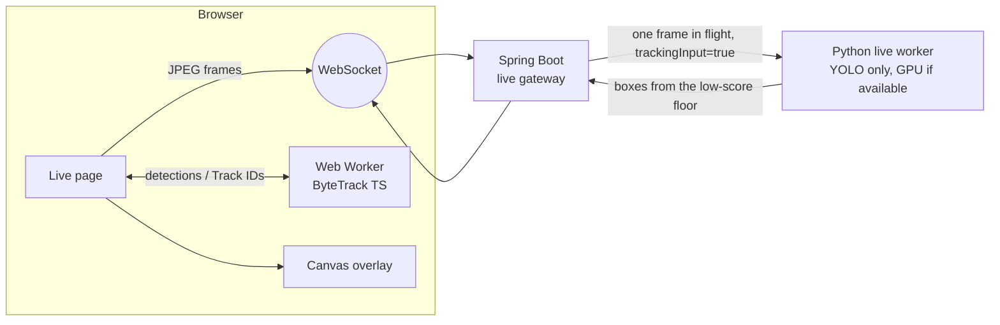
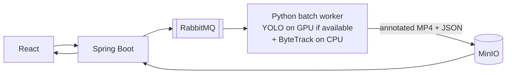

# Hybrid Tracking and GPU Acceleration

Branch `feature/hybrid-tracking-gpu`, based on `feature/quantization-frontend-integration` (`90abc58`).

**Status.** Implemented and unit, integration and parity tested. Not yet verified:

- **GPU and Docker end-to-end:** both image builds were stopped by the host for lack of memory (see §11).
- **CPU vs GPU benchmarks:** not run, for the same reason.

## 1. Previous architecture

- **Live Detection:** browser → Spring Boot (WebSocket) → Python live worker. With tracking on, the live worker ran YOLO **and** ByteTrack per session and returned Track IDs.
- **YouTube / batch:** Spring Boot → RabbitMQ → Python worker: YOLO, optional ByteTrack, annotated MP4, then MinIO.
- **Devices:** CPU only in every image (PyTorch CPU wheels), OpenVINO INT8 optional on the CPU.

## 2. New hybrid architecture





**Where tracking runs**

| Path | Tracking |
| --- | --- |
| Live, tracking on (new default) | Browser: ByteTrack in a dedicated Web Worker; the live worker only detects |
| Live, "Track in: Server" | Live worker: ByteTrack per session (legacy path, kept) |
| YouTube / batch | Python worker: ByteTrack on the CPU (unchanged) |

**Spring Boot's role:** validation, session handling, backpressure and transport only. It runs no inference and no tracking.

## 3. Live Detection data flow (CLIENT tracking)

1. The page sends `start` with `tracking: true, trackingMode: "CLIENT"`, and receives `ready` with `trackingMode: "CLIENT"`.
2. Frames go out as binary WebSocket messages (`[uint32 frameId][JPEG]`), **one at a time**, never faster than the session rate (≤ 5 FPS), and paused while the tab is hidden. This backpressure already existed and is unchanged.
3. Spring Boot calls `/internal/live/infer?…&trackingInput=true`.
   - The live worker runs YOLO at ByteTrack's low-score floor, `min(confidence, 0.1)`, and returns **every** box.
   - Low-score boxes are needed for ByteTrack's second association stage. The worker attaches no Track IDs and keeps no tracking state.
4. The `detections` message carries:
   - `frameId`, `width`, `height`, `detections` (`classId`, `label`, `confidence`, `box`);
   - `inferenceMs`, `serverMs`;
   - `trackingMode: "CLIENT"`, `lowScoreFloor`;
   - `device` (`cpu` or `cuda:N`) and `precision` (`FP32` or `INT8`): what the worker actually ran.
5. The page releases the pipeline at once (the next frame can be captured) and posts the detections to the Web Worker, which assigns Track IDs (§8).
6. The tracked result is drawn on the canvas.
   - **Mapping:** `object-fit: contain` letterbox mapping, mirroring, and device-pixel-ratio sizing (existing overlay code).
   - **Ordering:** a result older than the one already drawn is never drawn.

**Metrics shown:** each is labelled separately, and camera FPS is never presented as inference FPS.

| Tile | Meaning |
| --- | --- |
| Processed FPS | Results drawn per second |
| Sent FPS | Frames submitted per second |
| Latency | Send to draw, including tracking |
| Round trip | Send to detections received |
| Inference | YOLO time reported by the worker |
| Tracking (browser) | Web Worker ByteTrack time |
| Device | The device the worker reported |

## 4. YouTube / batch data flow

Unchanged:

- **Download and validation:** limits, the job lifecycle, outbox, RabbitMQ, retries and the dead-letter queue.
- **Processing modes:** Detection Only and Detection + Tracking (Python ByteTrack on the CPU).
- **Output:** MP4 encoding, MinIO, results, downloads and SSE progress.

YOLO runs on the GPU when the GPU image is used and `AI_DEVICE=auto` finds CUDA. The device is reported with each result (`inferenceDevice`). Tracking and encoding are unaffected by the device.

## 5. GPU compatibility and setup

**Detected on the development host**

| Component | Value |
| --- | --- |
| CPU | AMD Ryzen 5 5600H (6 cores / 12 threads) |
| Discrete GPU | NVIDIA GeForce GTX 1650, 4 GB, compute capability 7.5, driver 616.56 (CUDA up to 13.4) |
| Integrated GPU | AMD Radeon (not used: no supported YOLO/PyTorch GPU runtime was set up for it) |
| Docker GPU | Docker Desktop (WSL2) with the `nvidia` runtime; `nvidia-smi` inside a container lists the GTX 1650 |
| PyTorch | Project images ship CPU-only `torch 2.13.0+cpu`. `torch 2.13.0+cu126` / `torchvision 0.28.0+cu126` exist for Python 3.11 and support sm_75. |

**Setup (NVIDIA only)**

```powershell
docker compose -f compose.yaml -f compose.gpu.yaml up -d --build
docker compose exec ai-detection-consumer python -c "import torch; print(torch.cuda.is_available(), torch.cuda.get_device_name(0))"
```

What `compose.gpu.yaml` does:

- builds the AI images with `TORCH_VARIANT=cu126`;
- reserves one NVIDIA GPU for `ai-detection-consumer` and `ai-live-worker`;
- raises the live worker's memory limit to 4 GB (`LIVE_WORKER_GPU_MEMORY_LIMIT`).

The CUDA image is several GB larger than the CPU image, which is why it is opt-in. AMD and Intel GPUs are not supported: this setup includes no runtime for them.

## 6. CPU fallback and device policy

| `AI_DEVICE` | Effective device | Notes |
| --- | --- | --- |
| `auto` (default) | `cuda:0` if PyTorch sees CUDA, otherwise `cpu` | CPU image → always `cpu` |
| `cpu` | `cpu` | |
| `cuda:0` | `cuda:0`, or **error** | "CUDA device 0 was requested, but CUDA is unavailable. Use AI_DEVICE=auto or cpu, or run the GPU image (TORCH_VARIANT=cu126) with GPU access (compose.gpu.yaml)." Never a silent CPU run. |

**Reporting:**

- The effective device is logged at model load, e.g. `Loading model yolo11n on cuda:0 (NVIDIA GeForce GTX 1650) …`.
- It is reported per result (`inferenceDevice`) and per live frame (`device`).

These four things stay distinct:

- **Requested precision:** `inferencePrecision`.
- **Effective precision:** `effectivePrecision`.
- **Runtime:** `inferenceRuntime`.
- **Device:** `inferenceDevice`.

FP32 and INT8 models, and models on different devices, are separate cached instances with separate locks. Models load once per process, not per frame.

## 7. OpenVINO INT8 compatibility

- **Always on the CPU.** INT8 artifacts are OpenVINO CPU models and are never sent to CUDA.
- **`auto` on a GPU host:** INT8 jobs run on the CPU (`intel:cpu`), while FP32 jobs use the GPU.
- **FP32 fallback:** if INT8 falls back to FP32 (legacy global setting, no artifact), the FP32 model follows `auto` again and uses the GPU.
- **Explicit `cuda:0` with INT8:** a configuration error ("INT8 OpenVINO models run on CPU only").

## 8. Frontend ByteTrack

**Location:** `frontend/src/lib/tracking/`. It's a port of Ultralytics' `BYTETracker` (8.4.207), the tracker both Python workers use.

**Ported behaviour**

| Part | What it does |
| --- | --- |
| Kalman filter | XYAH constant velocity, identical noise weights (`kalmanFilter.ts`) |
| First association | High-score boxes (≥ confidence) vs tracked and lost tracks, score-fused IoU, threshold 0.8 |
| Second association | Low-score boxes (between floor and confidence) vs remaining tracked tracks, IoU, threshold 0.5 |
| Unconfirmed tracks | Matched with threshold 0.7; removed if unmatched |
| New tracks | From boxes ≥ confidence; confirmed in the next frame, or immediately in the first frame |
| Lost tracks | Kept for `trackBuffer` frames (10 live, like `LIVE_TRACKING_TRACK_BUFFER`) and re-found with the same ID |
| Duplicates | Tracked vs lost duplicates (IoU > 0.85) resolved in favour of the older track |
| Removed tracks | Buffer of 1,000 |

**Assignment:** `lap.lapjv(extend_cost=True, cost_limit)` semantics, reproduced with an optimal Hungarian solver on the same extended matrix (`linearAssignment.ts`).

**Numerics:**

- Boxes, scores and IoU use float32 rounding where NumPy uses float32; the Kalman filter uses float64.
- The reporting rule matches the Python `ObjectTracker`: every box at or above the confidence, plus lower-score boxes that continued a track, in input order, with IDs only for confirmed tracks.
- A reference quirk is kept on purpose: a lost track removed in one frame is still in the lost pool, and re-findable, for one more frame.

**Web Worker:** `workers/tracker.worker.ts` and `TrackerHost`.

- **Messages:** `INIT`, `TRACK_FRAME` (`sessionId`, `frameId`, `timestampMs`, `width`, `height`, `detections`), `RESET` and `CLOSE`. Responses: `READY`, `TRACKED` (objects, active tracks, `trackingMs`, `restarted`), `SKIPPED` (`STALE` or `UNKNOWN_SESSION`), `CLOSED`, `ERROR`.
- **Isolation:** one tracker per live session, with IDs from 1; never shared between sessions.
- **Ordering:** stale or out-of-order frames are skipped, never fed to ByteTrack.
- **Dropped frames:** frames the server dropped never arrive. Each processed frame is one tracker step, exactly like the server-side live tracker, so timing is not distorted.
- **Long pauses:** a pause longer than 30 s (the server's live session TTL) starts a fresh tracker.
- **Bounded memory:** at most 4 sessions, removed tracks capped at 1,000.
- **Cleanup:** the worker is terminated when the session ends (stop, fatal error, socket close, unmount).
- **Fallback:** without module Workers, the same host runs in-process.
- **Failure:** if the worker fails, detections are still drawn (without IDs) and a warning is shown.

**Intentional differences from the server tracker in live mode**

- The browser receives boxes rounded to 0.1 px and confidences to 4 decimals, because the live worker rounds its JSON. The server tracker uses unrounded boxes.
- The browser tracker does not keep trajectories; the overlay draws its own short trails.

## 9. API and message changes (all additive)

**Live start message:** optional `trackingMode` (`SERVER` or `CLIENT`).

- Absent, with `tracking: true`, means `SERVER`: the previous behaviour.
- Other values are `INVALID_SETTINGS` (`errors.trackingMode`), and so is combining `trackingMode` with `tracking: false`.

**Live `ready`:** adds `trackingMode`.

**Live `detections`:** adds `trackingMode`, `lowScoreFloor` (CLIENT), `device` and `precision` when the worker reports them. Detection-only messages from workers that don't report execution details are byte-for-byte unchanged.

**Internal live worker API**

- `trackingInput=true` query parameter; it can't be combined with `tracking=true`.
- The response adds `device`, `precision`, `trackingInput` and `lowScoreFloor`.

**Batch**

- The completion event `result` adds `inferenceDevice` (validated as `cpu` or `cuda:N`).
- Flyway **V10** adds a nullable `detection_results.inference_device` column with a CHECK constraint.
- `GET /api/v1/detections/{id}/result` adds `inferenceDevice`; job details show "PyTorch FP32 · GPU (cuda:0)".

## 10. Docker configuration

| File | Change |
| --- | --- |
| `ai-worker/Dockerfile` | `ARG TORCH_VARIANT=cpu` (`cpu` or `cu126`; anything else fails the build) selects `requirements-ai-<variant>.txt` before `requirements-ai.txt`. |
| `ai-worker/requirements-ai-cu126.txt` | Adds the CUDA 12.6 wheels. |
| `compose.gpu.yaml` | New, opt-in overlay (§5). `compose.yaml` and `.env` defaults are unchanged; `docker compose config` without the overlay contains no GPU settings. |

The default image keeps the same pins, but the changed `RUN` line rebuilds its PyTorch layer once. No volumes are created, removed or changed.

## 11. Test results (measured on this branch)

| Suite | Result |
| --- | --- |
| AI worker (`pytest`, from `ai-worker/`) | **493 passed**, 0 failed, 10 skipped (5 need FFmpeg, absent on the Windows host; 5 need `IT_*` broker settings) |
| Backend unit (`mvnw test`) | **430 passed**, 0 failed |
| Backend PostgreSQL integration (`-Ppostgres-it verify`, V10) | **Not rerun** after V10, because of the memory blocker below. V9 and earlier passed 70/70 on `feature/quantization-frontend-integration`. |
| Frontend (`tsc -b`, `vitest run`, `vite build`) | Typecheck clean; **285 passed**; production build emits `tracker.worker-*.js` (9 KB) as a module worker. Run in the project's frontend image (Node 24); the host's Node 22.14 is below the required version. |

**New tests**

- **Worker:**
  - INT8 runs on the CPU under `auto` on a GPU host, and is an error with `cuda:0`;
  - the FP32 fallback runs on the GPU;
  - the device reaches the completion event, and an invalid device is rejected;
  - tracker-input mode: low-score floor, no IDs, no state, stateless ordering, can't be combined with server tracking.
- **Backend:**
  - CLIENT sessions ask for tracker input and keep no worker state;
  - SERVER stays the default;
  - invalid modes are field errors;
  - execution details are forwarded.
- **Frontend:**
  - Kalman and assignment parity with Ultralytics and `lap`;
  - tracker lifecycle (confirmation, second stage, lost/re-found/retired, unconfirmed removal);
  - Web Worker host (session isolation, stale frames, gaps, reset, close, bounds);
  - Live page: CLIENT by default with real browser-side IDs, server option, worker terminated on stop, tracker failure fallback;
  - device display.

**Python vs TypeScript ByteTrack parity on real detections**

`benchmarks/tracker_parity.py` records real yolo11n detections (CPU, low-score floor, imgsz 640) and the Python `ObjectTracker` output; `parity.test.ts` replays them.

| Sequence | Frames | Boxes | Track IDs | Mismatched frames |
| --- | ---: | ---: | ---: | ---: |
| Traffic hold-out, 5 fps (live rate), buffer 10 | 119 | 2,240 | 44 | **0** |
| MOT17-09 pedestrians, 5 fps, buffer 10 (local fixture, not committed: CC BY-NC-SA) | 88 | 1,254 | 49 | **0** |
| Traffic hold-out, 25 fps (batch rate), buffer 30 | 200 | 2,711 | 30 | **0** |

The browser tracker assigned **identical Track IDs on every frame**, so continuity, fragmentation and ID changes are identical by construction. The Python replay in a Linux container also reproduced the fixtures exactly.

**Not verified (blocked)**

| Item | Status |
| --- | --- |
| GPU inside a container with CUDA PyTorch, real GPU inference, GPU memory | **Not done.** The CUDA image build was stopped by Claude Code because the host ran critically low on memory (0.4 GB of 13.9 GB free), as was the CPU image build from this branch. |
| CPU vs GPU latency comparison | **Not measured.** The harness is ready: `--include-cuda`. |
| Isolated Docker end-to-end (live with and without frontend tracking, YouTube with and without tracking, CPU fallback, GPU, INT8) | **Not run** this phase (needs the images above). The script `frontend/e2e/live-detection.mjs` (Playwright, fake camera) is written but has not been run. |
| Batch stage timing (detection, tracking, encoding, upload) | **Not measured** this phase |

## 12. Benchmark results (measured)

**Tracking cost per frame** (same fixtures, 4-CPU Linux containers on the same machine; TypeScript on Node 24, Python on Python 3.11):

| Sequence | Python ByteTrack, mean / P95 ms | TypeScript ByteTrack, mean ms (5 runs) | TypeScript P95 ms (range) |
| --- | --- | --- | --- |
| Traffic, 5 fps | 3.68 / 9.79 | 0.71–1.17 | 1.05–4.92 |
| Traffic, 25 fps | 2.42 / 5.20 | 0.71–0.89 | 1.20–2.18 |
| MOT17-09, 5 fps | 2.15 / 4.08 | 1.30–1.93 | 2.06–3.68 |

**What the timings mean**

- These were measured while an image build ran in the background, so they include some noise.
- Node is not a browser. Real browser timings, and the Web Worker messaging overhead, still need measuring on the actual page.
- Either way, tracking costs a few milliseconds per frame, against 40–100+ ms for CPU YOLO inference measured in earlier phases.
- **No claim is made that frontend tracking improves end-to-end performance;** that is not measured yet.

YOLO CPU/GPU, live end-to-end and batch stage timings are not available (§11).

## 13. Known limitations

- **GPU acceleration is unverified on this host;** see §11.
  - The GTX 1650 has 4 GB of VRAM: Nano and Small models fit, larger ones may not.
  - The live worker and the detection consumer would share one GPU.
- **AMD and Intel GPUs** are not supported.
- **Live browser tracking sees rounded boxes** (0.1 px, 4-decimal confidences), so its IDs can differ from server-side live tracking in rare edge cases. On identical input they are identical.
- **Low-score tracker input makes CLIENT-mode detection messages larger** than detection-only messages.
- **Browser metrics** (rendering, worker overhead) were measured only in component tests, not in a real browser.

## 14. Rollback

| What to roll back | How |
| --- | --- |
| Live tracking back on the server | Choose "Track in: Server" on the page, or revert `3cb2050`. The server path is unchanged. |
| GPU | Run without `compose.gpu.yaml` (the default), or set `AI_DEVICE=cpu`. |
| Database | V10 is additive and nullable. Older code ignores the column. |
| Code | Each phase is its own commit: `ef11488` GPU and device reporting, `79fb2f9` live tracker input, `49cbc60` TypeScript ByteTrack, `3cb2050` live integration, `501889f` benchmark tooling. |
