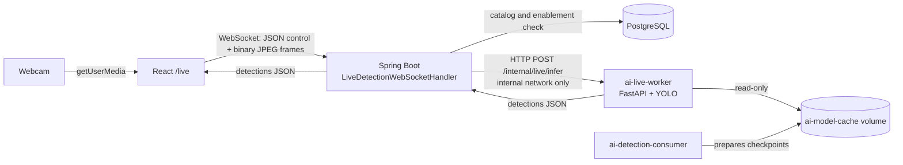
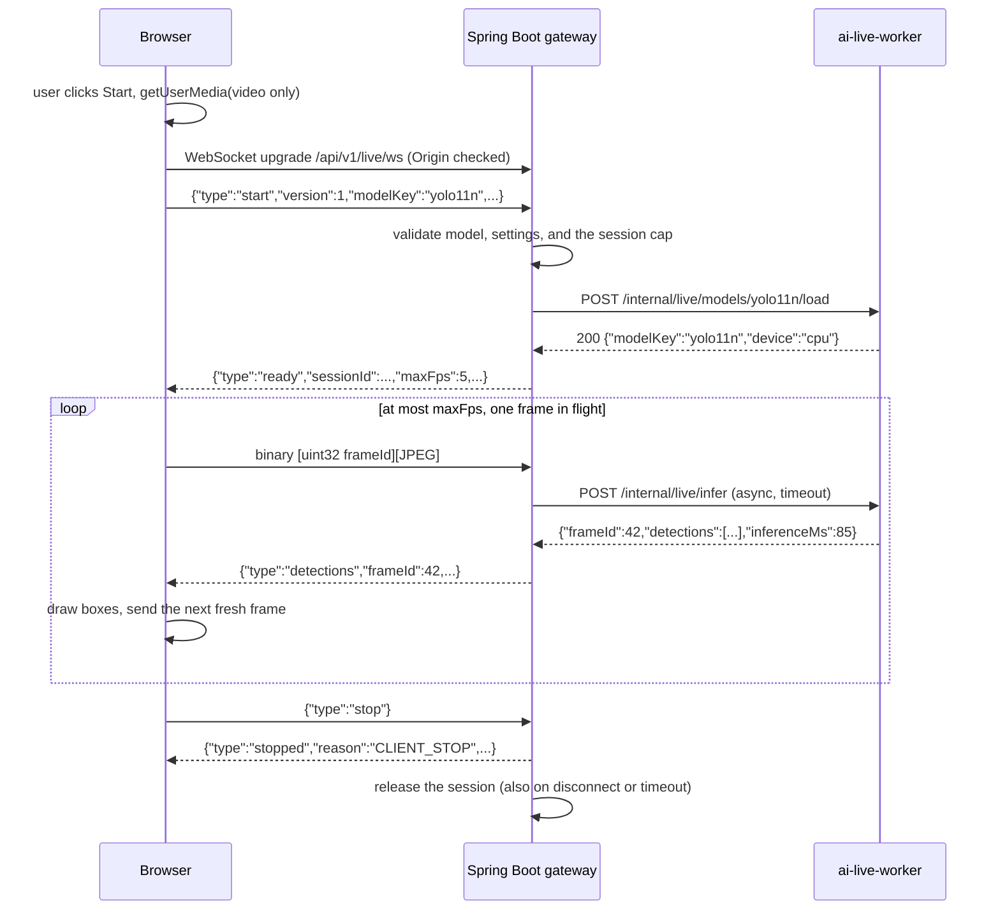

# Live Detection: real-time webcam object detection

Live Detection runs YOLO on frames from the user's own webcam (a laptop camera or a USB camera) and draws bounding boxes over the live preview.

It is an **independent workflow** next to the video-processing pipeline. It creates no `DetectionJob` rows, sends no frames through RabbitMQ, and stores nothing in MinIO or PostgreSQL. Frames exist only in memory for the duration of one inference.

> **Trust boundary.** Like the rest of the application, Live Detection has no authentication. It is for `localhost` or a trusted self-hosted network only. WebSocket origin checks reduce cross-site abuse, but origin validation is **not** authentication.

## 1. Components

| Component | Responsibility |
| --- | --- |
| **Browser** (`/live`, React) | Requests camera access only when the user starts, captures frames with `getUserMedia`, sends down-scaled JPEGs over one WebSocket with at most one frame in flight, and draws results on a canvas overlay. Measures FPS and latency |
| **Spring Boot** `LiveDetectionWebSocketHandler` (`/api/v1/live/ws`) | The only public entry point. Validates the session (model registered, enabled, detection, Nano size; confidence; image size; COCO classes). Enforces the session cap, frame size, frame rate, and one frame in flight. Forwards frames asynchronously to the worker and returns results only to the originating session. Idle and maximum-duration timeouts; idempotent cleanup |
| **`ai-live-worker`** (Python, FastAPI, same image as the other workers) | Internal-only HTTP API on the Compose network. Decodes JPEG with OpenCV, validates size and dimensions, and runs YOLO through the existing `ModelLoader`/`DetectionService`. One inference at a time; a bounded number of loaded models; returns JSON detection metadata. Reads the model cache **read-only** and never downloads weights |
| Existing services | PostgreSQL: model catalog and enablement (read-only use). The consumer and `ai-worker`: unchanged; they prepare models into the shared cache |



## 2. Session sequence



## 3. WebSocket protocol (version 1)

**Text messages** are JSON objects with a `type`. **Binary messages** are camera frames.

### Client → server

| Message | Fields |
| --- | --- |
| `start` | `version` (1), `modelKey`, `confidence` (0–1, ≤ 3 decimals, default 0.25), `imageSize` (320, 416, or 640, default 416), `classes` (1–80 unique COCO IDs 0–79, default vehicles `[1,2,3,5,7]`) |
| binary frame | 4-byte big-endian unsigned `frameId`, followed by the JPEG bytes. At most `maxFrameBytes` |
| `stop` | none |

### Server → client

| Message | Fields |
| --- | --- |
| `ready` | `version`, `sessionId`, `modelKey`, `maxFps`, `maxFrameBytes`, `maxInFlight` (1), `imageSize`, `confidence`, `classes` |
| `detections` | `frameId`, `width`, `height` (the submitted frame), `detections[]` of `{classId, label, confidence, box: [x1, y1, x2, y2]}` in **submitted-frame pixels**, `inferenceMs`, `serverMs` |
| `dropped` | `frameId`, `reason`: `BUSY` (another frame in flight) or `RATE_LIMITED` (faster than `maxFps`). Releases the client's in-flight slot |
| `error` | `code`, `message` (fixed, client-safe), `fatal` (boolean), optional `frameId` |
| `stopped` | `reason` (`CLIENT_STOP`, `IDLE_TIMEOUT`, `MAX_DURATION`, `SERVER_SHUTDOWN`), `processedFrames`, `droppedFrames` |

**Error codes:**

| Category | Codes |
| --- | --- |
| Setup | `INVALID_MESSAGE`, `UNSUPPORTED_VERSION`, `INVALID_SETTINGS` (with `errors`), `MODEL_NOT_FOUND`, `MODEL_DISABLED`, `MODEL_NOT_SUPPORTED`, `MODEL_NOT_PREPARED`, `SESSION_LIMIT_REACHED`, `ALREADY_STARTED`, `NOT_STARTED` |
| Frames | `INVALID_FRAME`, `FRAME_TOO_LARGE` |
| Inference | `WORKER_UNAVAILABLE`, `INFERENCE_TIMEOUT`, `INFERENCE_FAILED` |

Setup errors and `SESSION_LIMIT_REACHED` are fatal: the server sends the error, then closes. Per-frame errors are not fatal, so the client may continue.

**Close codes:**

| Code | Meaning |
| --- | --- |
| 1000 | After `stopped` |
| 1008 | Policy or validation failure, after a fatal `error` |
| 1009 | Message larger than the transport limit (Tomcat) |
| 1011 | Unexpected server error |

Any close, including an unexpected disconnect, releases the session immediately.

**Tracking extension (future):** detections may later carry an optional `trackId`, and `stopped` may add per-session statistics. Tracker state would be scoped to one `sessionId` and discarded with it.

## 4. Internal worker contract (not published to the host)

| Endpoint | Purpose |
| --- | --- |
| `GET /health` | Liveness (shared with the other worker images) |
| `POST /internal/live/models/{modelKey}/load` | Validates and loads a prepared model; returns `{modelKey, device, classes}` |
| `POST /internal/live/infer?modelKey=&frameId=&confidence=&imageSize=&classes=1,2,3` | Body: raw JPEG (`Content-Type: image/jpeg`). Returns `{frameId, width, height, detections[], inferenceMs, modelKey}` |

Errors are `{"error": {"code": "...", "message": "..."}}`:

| Status | Codes |
| --- | --- |
| 400 | `INVALID_FRAME`, `INVALID_PARAMETERS` |
| 404 | `MODEL_NOT_SUPPORTED` |
| 409 | `MODEL_NOT_PREPARED` |
| 413 | `FRAME_TOO_LARGE` |
| 429 | `WORKER_BUSY` |
| 500 | `INFERENCE_FAILED` |
| 503 | `MODEL_LOAD_FAILED` |

## 5. Backpressure and resource limits

| Limit | Default | Where |
| --- | --- | --- |
| Concurrent live sessions | 1 | Gateway (`LIVE_MAX_SESSIONS`) |
| Frames in flight per session | 1 | Gateway (always) and browser |
| Input rate | 5 FPS | Gateway (`LIVE_MAX_FPS`) and browser |
| Frame size | 512 KiB (JPEG) | Gateway, Tomcat buffer, and worker (`LIVE_MAX_FRAME_BYTES`) |
| Frame dimensions | ≤ 1280 × 1280 pixels and ≤ 921,600 pixels | Worker |
| Capture size | 640 × 480 requested, scaled to ≤ 640 px wide | Browser |
| Inference timeout | 5 s | Gateway (`LIVE_INFERENCE_TIMEOUT`) |
| Model load timeout | 60 s | Gateway |
| Idle session | 30 s without frames | Gateway (`LIVE_IDLE_TIMEOUT`) |
| Maximum session | 30 min | Gateway (`LIVE_MAX_SESSION_DURATION`) |
| Concurrent inferences | 1 | Worker (`LIVE_MAX_CONCURRENT_INFERENCES`) |
| Loaded models | 1 (least recently used is evicted) | Worker (`LIVE_MAX_LOADED_MODELS`) |
| CPU threads and memory | 2 threads, 2 GB limit | Compose (`LIVE_CPU_THREADS`, `LIVE_WORKER_MEMORY_LIMIT`) |

The policy is **latest frame wins, never a queue**:

- The browser sends a new frame only after the previous one is answered (`detections`, `dropped`, or `error`), and always captures a fresh frame.
- The gateway drops, with a notice, any frame that arrives while one is in flight or faster than `maxFps`.
- The worker answers `429` instead of queueing.

There is no buffer anywhere in the path that can grow with time.

Inference never runs on WebSocket I/O threads. The gateway forwards each frame with the JDK `HttpClient` (`sendAsync`), and the worker runs YOLO in a worker thread (`anyio.to_thread`) behind a semaphore. Outgoing WebSocket messages go through `ConcurrentWebSocketSessionDecorator`, with bounded send time and buffer.

## 6. Failure handling

| Failure | Behaviour |
| --- | --- |
| Camera denied, missing, busy, unsupported, or insecure context | A clear message on the page; nothing is sent |
| Camera unplugged during a session | The track's `ended` event stops the session and releases everything |
| WebSocket closes unexpectedly | The page stops capture, releases the camera, clears the overlay, and shows "Connection lost" |
| Worker down or restarting | `start` fails with `WORKER_UNAVAILABLE`; during a session, frames get non-fatal `WORKER_UNAVAILABLE` errors until it returns |
| Slow inference | At most one frame waits; it fails with `INFERENCE_TIMEOUT` after 5 s, and the next fresh frame follows |
| Malformed frame | `INVALID_FRAME` (non-fatal); the worker never writes frames to disk |
| Model enabled but not prepared in the shared cache | `start` fails with `MODEL_NOT_PREPARED` and preparation instructions |
| Browser tab hidden | Capture pauses while the page is hidden; the idle timeout ends abandoned sessions |
| Session ends while a frame is being inferred | The pending call is abandoned, not aborted: its result is discarded, the worker finishes it within the inference timeout, and the worker semaphore keeps it from overlapping a new session's frame |

## 7. Security boundaries

- The browser reaches only Spring Boot. The live worker has **no host port**.
- WebSocket origins are limited to same-origin requests plus `CORS_ALLOWED_ORIGINS` (never `*`).
- Messages are size-limited at Tomcat and in the application, the session count is capped, and every setting is validated.
- Model keys are checked against the catalog and the worker's registry. File paths are never accepted, and nothing is fetched from client-supplied URLs.
- Frames are never logged or stored; logs contain only session IDs, frame counts, and timings.
- Camera access requires a secure context: `http://localhost` works, but other hosts need HTTPS (see the deployment guide).

## 8. Docker deployment

`ai-live-worker` is a separate Compose service built from the existing `ai-worker` image:

- **Command:** `python -m app.live_server`.
- **Network:** internal only.
- **Model cache:** `ai-model-cache` mounted at `/data/models` **read-only**.
- **Health check:** the image's existing `/health` check.
- **Limits:** bounded CPU threads and memory.

The backend reaches it at `LIVE_WORKER_URL` (default `http://ai-live-worker:8000` in Compose). The frontend proxies (Vite with `ws: true`; nginx with `Upgrade` headers) carry `/api/v1/live/ws` same-origin. The production layout still publishes only the frontend port.

## 9. Testing strategy

| Layer | Approach |
| --- | --- |
| Python | FastAPI TestClient with a mocked loader/predictor: valid contract, invalid JPEG, oversize, unsupported, unprepared or invalid models, empty results, coordinates, class filtering, model reuse and eviction, failures, busy (429). Optional real YOLO11n inference when a verified checkpoint is present |
| Spring Boot | Handler tests with a stub worker client (every protocol rule), plus a real-Tomcat WebSocket test against a fake worker HTTP server (origin rejection, binary frames, backpressure, timeouts, cleanup) |
| React | Vitest with mocked `getUserMedia`, `enumerateDevices`, and `WebSocket`: permissions, devices, models, start/stop, throttling, one in flight, rendering, errors, cleanup |
| Browser | Chrome with a synthetic fake camera (`--use-fake-device-for-media-stream`) against the real stack. A physical webcam is reported separately if one is available |

## 10. Operating Live Detection

### Start and open the page
1. Start the stack as usual (`docker compose up -d --build`, or the self-hosted layout). The `ai-live-worker` service starts with it; it has no host port.
2. Prepare a Nano detection model in the shared cache. The live worker never downloads weights, and its cache mount is read-only:
   ```powershell
   docker compose exec ai-detection-consumer python -m app.cli models prepare --model yolo11n --device cpu
   ```
3. Enable that model as described in the [model management guide](yolo-model-management.md). Live Detection offers only models that are enabled, `DETECT`, and of an allowed size (`LIVE_MODEL_SIZES`, Nano by default).
4. Open `/live` (for example `http://localhost:5173/live`, or the self-hosted UI port), choose a camera and a model, and select **Start Live Detection**. The browser asks for camera permission the first time.

### Localhost and HTTPS
Browsers expose the camera only in a secure context. `http://localhost` and `http://127.0.0.1` count as secure. Any other host name or LAN address needs HTTPS in front of the frontend (see the [deployment guide](deployment-guide.md)). Otherwise the page explains that the camera needs a secure connection, and nothing is sent. When the UI is served from another origin, add that origin to `CORS_ALLOWED_ORIGINS`; the WebSocket handshake uses the same list.

### Tuning
| Setting | Effect |
| --- | --- |
| `LIVE_MAX_FPS` | Upper bound on frames per second (the browser never exceeds 5) |
| `LIVE_CPU_THREADS`, `LIVE_WORKER_CPUS`, `LIVE_WORKER_MEMORY_LIMIT` | CPU threads, CPU quota, and memory for the live worker |
| `LIVE_MAX_FRAME_BYTES` | Largest accepted JPEG frame (gateway and worker) |
| `LIVE_INFERENCE_TIMEOUT`, `LIVE_IDLE_TIMEOUT` | When a slow frame fails, and when an idle session ends |
| `LIVE_MODEL_SIZES` | Model sizes offered for live use, such as `n` or `n,s`. Larger models are slower on CPU |
| Image size (page setting) | 320 px is fastest; 640 px detects small objects better |

### Troubleshooting
| Symptom | Cause and fix |
| --- | --- |
| "Camera permission was denied" | Allow the camera in the browser's site settings, then start again |
| Secure-context message | Open the page through `localhost` or serve it over HTTPS |
| `MODEL_NOT_PREPARED` | Run the `models prepare` command shown in the message on `ai-detection-consumer` |
| `WORKER_UNAVAILABLE` | Check `docker compose ps ai-live-worker` and its logs. During a session, frames resume when the worker is back |
| `SESSION_LIMIT_REACHED` | Another tab or user has a live session. Stop it, or raise `LIVE_MAX_SESSIONS` if the CPU allows |
| Handshake rejected (HTTP 403) | The page's origin is not the backend's own origin and is not in `CORS_ALLOWED_ORIGINS` |
| Low FPS or high latency | CPU-bound inference: use 320 px, fewer competing jobs, or more `LIVE_WORKER_CPUS` |

The live worker logs model loads, warm-up, evictions, and inference failures. It does not log individual requests. Spring Boot logs each session's start and end, with frame counts.

## 11. Measured results (reference only)

These figures come from one validation run, not a benchmark. Setup:
- **Host:** a Windows laptop with Docker Desktop.
- **Live worker:** limited to 2 CPUs and 2 threads, running YOLO11n at 416 px with the *Vehicles* classes.
- **Path:** headless Chrome with a synthetic 640 × 480 camera, through the self-hosted nginx layout.

Results on other hardware will differ.

| Measurement | Observed |
| --- | --- |
| Start to first detection (model load and warm-up) | about 4–6 s |
| Processed rate | 4.1–5.0 FPS; 2.8 FPS while a video job ran at the same time |
| Round-trip latency per frame | about 30–200 ms (inference about 25–180 ms) |
| Gap between frames sent by the browser | at least 203 ms |
| Live worker memory | about 300–330 MiB with one model loaded |
| Live worker CPU | about 1.1–1.5 of its 2 cores while a session runs |
