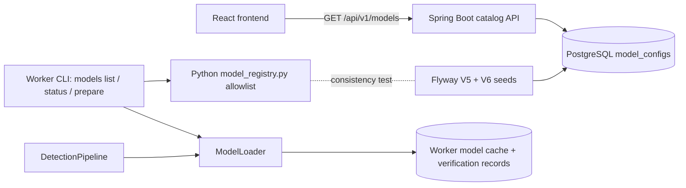

# YOLO model management

Phase 04 adds a catalog of 20 pretrained Ultralytics **object detection** checkpoints across four YOLO families and five sizes. It adds read-only Spring Boot catalog APIs, dynamic model selection in the Python engine, and an explicit worker-side workflow to prepare and inspect the cache. Segmentation, pose, classification, oriented boxes, and custom model uploads are out of scope.

## 1. Architecture



- **PostgreSQL is authoritative** for which models the application offers and for whether each one is administratively enabled.
- **The worker's `app/services/model_registry.py` is the inference allowlist.** It maps a key to an official checkpoint filename. Clients choose a key and never a path, URL, or filename.
- **Drift is prevented by tests.** `ai-worker/tests/test_model_registry.py` parses every Flyway `INSERT INTO model_configs` statement and requires the exact same `(key, version, size, task, filename)` set as the registry. It also requires that seeds never enable a model or update existing rows. A shared definition file was not used because the backend and worker Docker build contexts are separate directories.

## 2. Supported families and sizes

| Version label | Keys and official checkpoints |
| --- | --- |
| `YOLOv8` | `yolov8n` → `yolov8n.pt`, `yolov8s` → `yolov8s.pt`, `yolov8m` → `yolov8m.pt`, `yolov8l` → `yolov8l.pt`, `yolov8x` → `yolov8x.pt` |
| `YOLO11` | `yolo11n` → `yolo11n.pt`, `yolo11s` → `yolo11s.pt`, `yolo11m` → `yolo11m.pt`, `yolo11l` → `yolo11l.pt`, `yolo11x` → `yolo11x.pt` |
| `YOLO12` | `yolo12n` → `yolo12n.pt`, `yolo12s` → `yolo12s.pt`, `yolo12m` → `yolo12m.pt`, `yolo12l` → `yolo12l.pt`, `yolo12x` → `yolo12x.pt` |
| `YOLO26` | `yolo26n` → `yolo26n.pt`, `yolo26s` → `yolo26s.pt`, `yolo26m` → `yolo26m.pt`, `yolo26l` → `yolo26l.pt`, `yolo26x` → `yolo26x.pt` |

| Size | Name |
| --- | --- |
| `n` | Nano |
| `s` | Small |
| `m` | Medium |
| `l` | Large |
| `x` | Extra Large |

All rows use task type `DETECT`. The pinned `ultralytics-opencv-headless==8.4.207` supports all four families, so no dependency changed. The engine default remains `yolo26s`.

## 3. Model status semantics

These four states are independent. None implies the next.

| State | Where it is recorded | Meaning |
| --- | --- | --- |
| **Cataloged** | A `model_configs` row | The application knows the model. |
| **Enabled** | `model_configs.enabled` | An administrator allows users to select it. All 20 seeded rows are disabled. |
| **Cached** | `<AI_MODEL_CACHE_DIR>/<key>.pt` in a worker runtime | The checkpoint file exists in that runtime's cache. It may still be corrupt. |
| **Verified** | `<AI_MODEL_CACHE_DIR>/verification/<key>.json` | That exact file (size and modification time) was loaded successfully as a detection model by that runtime. The record also stores the device and the Ultralytics and PyTorch versions. |

Worker status values are `NOT_CACHED`, `CACHED_UNVERIFIED`, `VERIFIED`, and `CHANGED_SINCE_VERIFICATION`. The last one means the file was replaced after it was verified. Verification lives inside the cache directory. A model verified on a Windows developer cache therefore says nothing about the Docker `ai-model-cache` volume, which must be prepared separately. The backend API reports only catalog membership and enablement. It never reports a model as ready for inference.

## 4. PostgreSQL catalog

`V6__seed_yolo_detection_model_catalog.sql` inserts all 20 rows with `enabled = FALSE` and `ON CONFLICT (model_key) DO NOTHING`. The table and entity are unchanged. Applied migrations V1–V5 were not edited. Existing rows are left untouched, including the V5 `yolo26s` UUID, its enabled flag, its timestamps, any administrator edits, and `detection_jobs` foreign keys. A PostgreSQL integration test migrates a schema to V5 and modifies it like an administrator would. It then applies V6 and asserts that all of this is preserved.

### Enabling a model (administrator)

Enable a model only after it is `VERIFIED` in the worker runtime that will serve it:

```powershell
docker compose exec ai-worker python -m app.cli models prepare --model yolo11n --device cpu
docker compose exec ai-worker python -m app.cli models status --model yolo11n
```

```sql
UPDATE model_configs SET enabled = TRUE, updated_at = CURRENT_TIMESTAMP WHERE model_key = 'yolo11n';
```

Disable a model with `enabled = FALSE`. There is no REST endpoint for this, because authentication is not implemented yet.

## 5. Spring Boot REST API (read-only)

These endpoints work while the worker is offline. They return actual database rows using `ModelConfigResponse`. Errors use RFC 9457 problem details.

| Endpoint | Description |
| --- | --- |
| `GET /api/v1/models` | All models, or a filtered list. Optional `version` (`YOLO` label such as `YOLOv8`), `size` (`n`/`s`/`m`/`l`/`x`), and `enabled` (`true`/`false`). Sorted by release generation (YOLOv8, YOLO11, YOLO12, YOLO26), then size n→x. |
| `GET /api/v1/models/versions` | Distinct registered versions in release order. This literal route takes precedence over `{modelKey}`. |
| `GET /api/v1/models/{modelKey}` | One model. Unknown or malformed keys return 404. |

```json
GET /api/v1/models?version=YOLO26&size=s
{
  "models": [{
    "id": "…", "modelKey": "yolo26s", "version": "YOLO26", "modelSize": "s",
    "taskType": "DETECT", "weightsFilename": "yolo26s.pt", "enabled": false,
    "createdAt": "…", "updatedAt": "…"
  }],
  "total": 1
}

GET /api/v1/models/versions
{"versions": ["YOLOv8", "YOLO11", "YOLO12", "YOLO26"]}
```

| Situation | Response |
| --- | --- |
| Malformed filter, e.g. `size=xl`, `version=yolo26`, `enabled=sometimes` | 400, `"detail": "Request validation failed."`, plus a per-field `errors` map |
| Well-formed filter with no matches, e.g. `version=YOLOv5` | 200 with `total: 0` |
| Unknown model | 404, `"title": "Model not found"`. The key is not echoed back. |
| Database unavailable | 503, `"The data store is temporarily unavailable."`. Internal details are logged, not returned. |
| `POST`/`DELETE` | 405. There are no preparation or download endpoints. |

## 6. Python model loading

`ModelLoader.load(model_key, device, allow_download)` still loads lazily and caches per process. Only an explicit preparation or an inference request triggers a load.

- The key must be in the registry. Paths, URLs, filenames, uppercase variants, and task-suffixed keys such as `yolo26s-seg` are rejected before any import or load.
- The checkpoint path is always `<cache>/<official filename>`. Symlinks and paths outside the cache are rejected.
- After loading, the checkpoint's own task must be `detect`. Class names come from the loaded model, so class filtering validates against the model's metadata rather than a fixed list of 80 COCO classes. The default classes remain `[1, 2, 3, 5, 7]` (bicycle, car, motorcycle, bus, truck).
- The process cache key is `(cache directory, model key, device)`. Different models never share an entry.
- `auto` uses `cuda:0` when available and otherwise falls back to CPU. An explicit `cuda:0` fails clearly when CUDA is missing. CPU runs use `AI_CPU_THREADS`.
- A successful load writes the verification record atomically. A failed load is not cached or verified, and does not delete the file, so an operator can inspect it.
- Result JSON records the model that was actually loaded (`modelKey`, `modelVersion`, `modelSize`, `weightsFilename`, `statistics.modelKey`), not merely the one requested.

## 7. Cache management and CLI

```powershell
cd ai-worker
.\.venv\Scripts\python.exe -m app.cli models list            # registry only; no cache access
.\.venv\Scripts\python.exe -m app.cli models status          # cache + verification; never loads or downloads
.\.venv\Scripts\python.exe -m app.cli models status --model yolo11n --json
.\.venv\Scripts\python.exe -m app.cli models prepare --model yolo11n --device cpu
.\.venv\Scripts\python.exe -m app.cli detect --source temp/cli-input/street.mp4 --source-type local `
    --model yolo11n --confidence 0.25 --imgsz 640 --device cpu
.\.venv\Scripts\python.exe -m app.smoke --model yolo11n --device cpu
```

`models prepare` validates the key and resolves the official filename. If the file is missing, it downloads it through Ultralytics' own asset mechanism (`github.com/ultralytics/assets` releases) into `AI_MODEL_CACHE_DIR`. It then loads and verifies the checkpoint and reports the result. It exits 0 only when the model is `VERIFIED`, 1 when loading or downloading fails, and 2 for an unapproved key. An existing file is reused rather than downloaded again. The older `prepare-model` command remains as an alias. `models list`, `models status`, `--help`, and FastAPI startup never import PyTorch or Ultralytics and never download anything. Nothing prepares all 20 models automatically. Prepare large `l`/`x` models only on hardware that can run them.

`model-cache/` (including `verification/`) and `*.pt` are ignored by Git and excluded from the Docker build context.

## 8. Troubleshooting

| Symptom | Action |
| --- | --- |
| `Model preparation failed: <file> could not be loaded` after download retries | Check network access to `github.com/ultralytics/assets` (an HTTP 504 from GitHub was observed once during validation), then retry `models prepare`. No partial file or verification record is kept. |
| `CACHED_UNVERIFIED` | Run `models prepare` for that key. A file copied in manually is not trusted until it loads. |
| `CHANGED_SINCE_VERIFICATION` | The file was replaced. Run `models prepare` again. |
| Load fails on a cached file | The file may be corrupt. Delete `<cache>/<key>.pt` yourself and prepare again. The engine never deletes it automatically. |
| `… is a segment checkpoint` | Only detection checkpoints are accepted. |
| `Selected class identifiers are not supported by this model` | Choose class IDs that exist in the model's own class names. |
| `CUDA device 0 was requested, but CUDA is unavailable` | Use `--device auto` or `cpu`, or install a CUDA-enabled PyTorch build. |
| API returns 503 | PostgreSQL is unreachable. The worker is not involved. |

## 9. Future integration

- **React (Detection page):** load options from `GET /api/v1/models?enabled=true` and `/versions`. Present `enabled` as "available for selection", not "ready". Show worker readiness only once a backend contract reports it.
- **RabbitMQ (Phase 05):** job messages carry only `modelKey`. The worker validates it against the registry, loads with downloads governed by policy, and reports a load failure as a job failure. A worker heartbeat or status message could later publish per-model cache and verification state to the backend. That is not implemented here.

## 10. Security considerations

- There are no write or preparation endpoints, so unauthenticated users cannot trigger expensive downloads or change enablement.
- Clients cannot supply paths, URLs, or filenames. Keys are matched against fixed allowlists in both the backend (format check, then database lookup) and the worker (exact registry lookup).
- API responses and worker status JSON contain no filesystem paths. Error responses never echo user input or database internals.
- Downloads go only to official Ultralytics asset URLs that Ultralytics derives from the approved filename.

## 11. Licensing

Ultralytics YOLO software and pretrained weights are distributed under AGPL-3.0, with an Ultralytics Enterprise License available for other terms. Review the [official licensing information](https://www.ultralytics.com/license) before any commercial or network-service deployment. Weights are not redistributed in this repository.

## 12. Validation

Executed results are recorded in [phase-04-validation.md](phase-04-validation.md).

```powershell
cd backend;   .\mvnw.cmd -B test;  .\mvnw.cmd -B -Ppostgres-it verify   # ITs need Docker
cd ai-worker; .\.venv\Scripts\python.exe -m pytest -q
```
